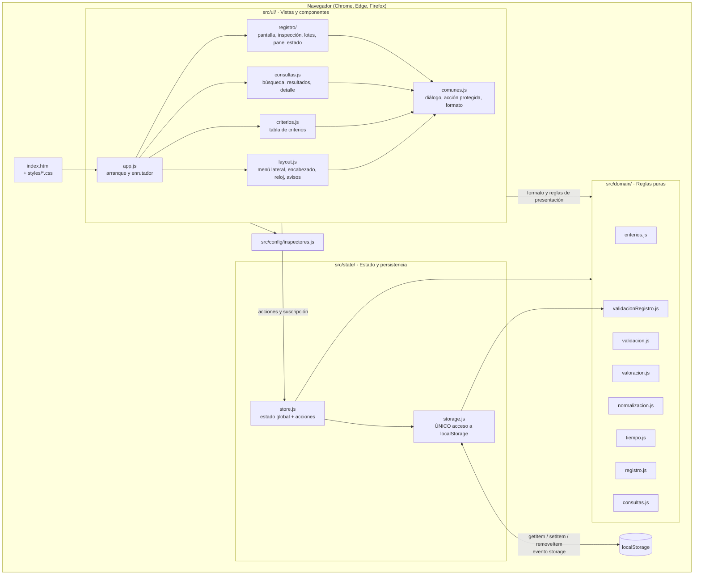
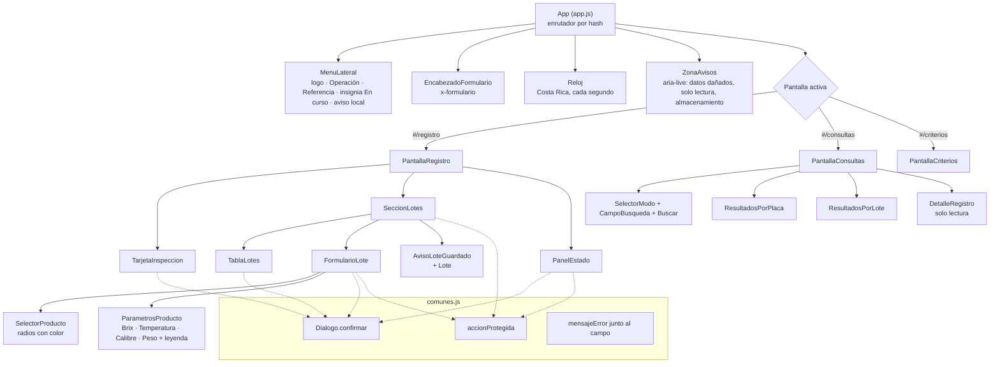
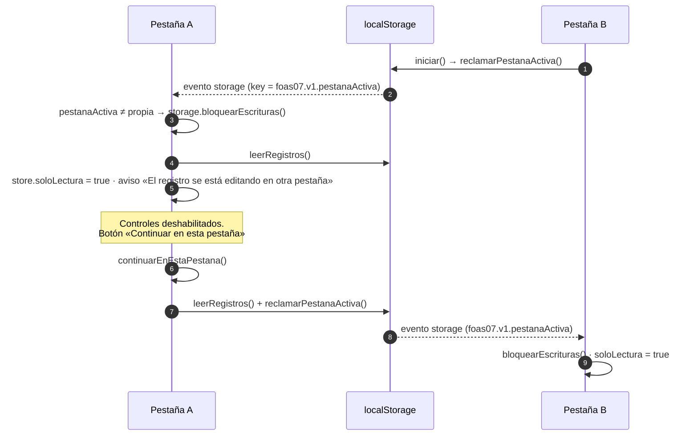
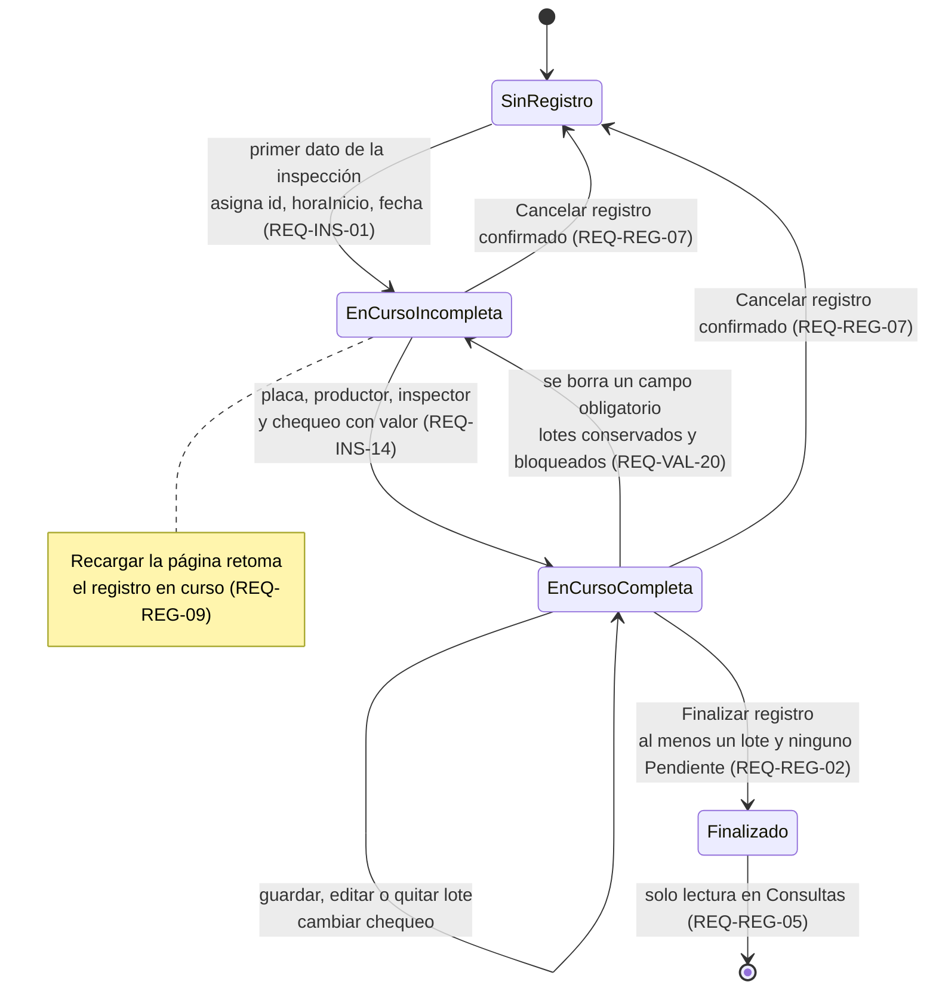
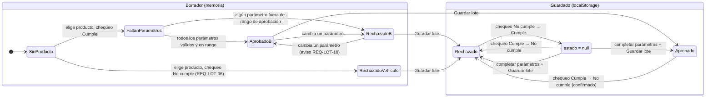
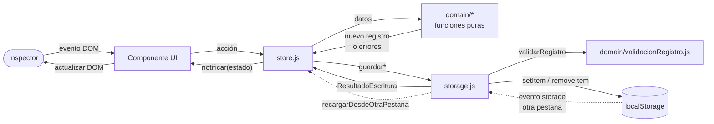
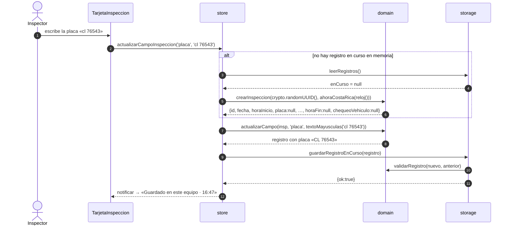
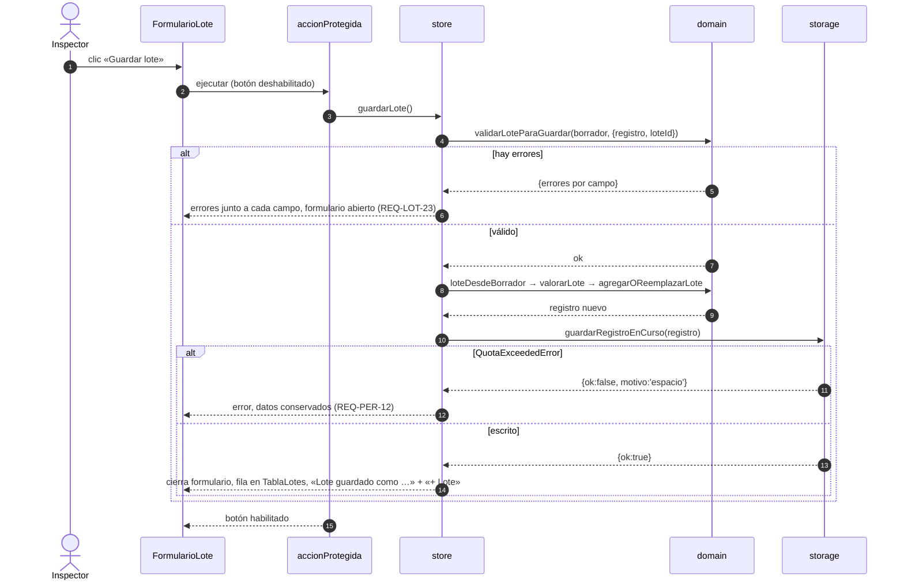
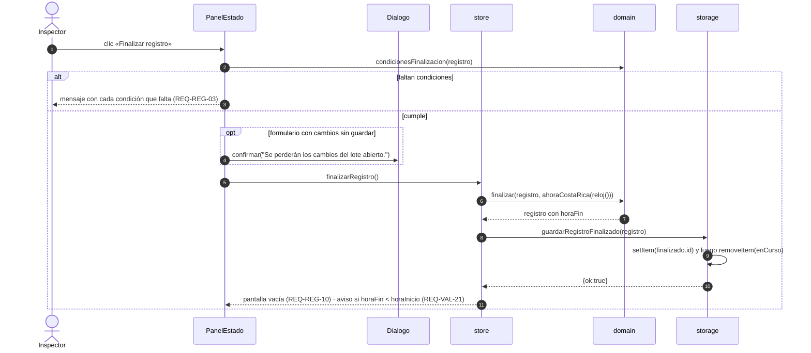

# Documento de diseño

## Aplicación web «Registro de inspección de vehículo y recepción de fruta» · Alimentos Bermúdez S.A.

| Elemento | Detalle |
| :---- | :---- |
| Documento | `docs/design.md` |
| Versión | 1.2.0 (decisiones DD-01 a DD-13 aprobadas por el Head Chef el 25/10/2026; DD-08b retirada) |
| Fecha | 25 de octubre de 2026 |
| Formulario digitalizado | FO-AS-07, versión 13 |
| Entradas | `requirements.md` v1.1.0, `data-contract.json` v1.0.0, `docs/wireframes/` 00 a 07, `CLAUDE.md` (lenguaje ubicuo, invariantes INV-01 a INV-20, stack D-01) |
| Enfoque | Spec Driven Development: cada decisión de este documento se justifica con un ID de requerimiento (REQ-XXX), una regla del contrato (`x-reglas`) o un invariante (INV-XX). Lo que no tiene respaldo en las fuentes se registra como **DD-XX (decisión de diseño)** en la sección 14, con su resolución por el Head Chef. |

---

## 1. Propósito y alcance

Este documento traduce la especificación EARS de `requirements.md` y el contrato `data-contract.json` en un diseño implementable con el stack D-01 (HTML, CSS y JavaScript nativo con ES Modules, sin dependencias). Define:

1. La arquitectura de componentes de la interfaz, derivada de los wireframes 00 a 07.
2. La estructura de módulos por capas (REQ-TEC-09) y el manejo de estado: qué vive en memoria (estado global), qué se persiste en `localStorage` y qué se deriva.
3. Los flujos de datos principales, en diagramas Mermaid.
4. El mapeo explícito de cada REQ-XXX al módulo y al mecanismo que lo satisface (sección 13), y de cada invariante INV-XX a su guardia y su prueba (sección 10).

Queda fuera de alcance todo lo listado en `requirements.md` §13.3: servidor, autenticación, sincronización, exportar, imprimir, reportes, cálculo del peso promedio a partir de la muestra, productos adicionales, campos «1/2 Orden compra calidad» y edición o borrado de registros finalizados.

---

## 2. Convenciones

- **Lenguaje ubicuo.** Código, comentarios, mensajes de la UI y este documento usan solo los términos de `CLAUDE.md` §2: *InspeccionVehiculo* (Inspección), *LoteMateriaPrima* (Lote), *Registro*, *Registro en curso*, *Registro finalizado*, *Inspección completa*, *Chequeo del vehículo*, *Producto*, *Parámetros*, *Estado*, *Pendiente de valorar*, *Motivo del rechazo*, *Observaciones*, *Rango de aprobación*, *Rango válido de entrada*, *Valor normalizado*, *Cambios sin guardar*, *Finalizar registro*, *Cancelar registro*, *Cerrar sin guardar*, *Quitar*.
- **Borrador** es el único término nuevo de este diseño: el contenido en memoria del formulario de un lote mientras el inspector lo edita y antes de «Guardar lote». No es una entidad del dominio y nunca se persiste (REQ-PER-03).
- Cada archivo `.js` empieza con `// @ts-check` y declara sus tipos con JSDoc `@typedef` (REQ-TEC-02).
- Nombres de funciones y variables en español, en `camelCase`, alineados con los campos del contrato.

---

## 3. Vista general de la arquitectura

### 3.1 Principios

| Principio | Consecuencia en el diseño | Origen |
| :---- | :---- | :---- |
| SPA sin dependencias ni compilación | `index.html` + ES Modules servidos tal cual por `scripts/serve.js`. | REQ-TEC-01, REQ-TEC-03 |
| Reglas puras y testeables | Todo cálculo (valoración, validación, normalización, tiempo, consultas, invariantes) vive en `src/domain/` como funciones puras, sin DOM ni `localStorage`. | REQ-TEC-09, RNF-12 |
| Un solo punto de persistencia | `src/state/storage.js` es el único módulo que toca `localStorage` y rechaza cualquier escritura que viole un invariante. | REQ-TEC-05, INV-01 a INV-20 |
| Estado global único en memoria | `src/state/store.js` mantiene el estado de la sesión de la pestaña y notifica a la UI. La UI nunca muta el estado directamente: llama acciones del store. | REQ-TEC-09 |
| Escritura pesimista | El store confirma un cambio en memoria solo después de que `storage.js` informa que la escritura fue exitosa. | REQ-PER-12 |
| Una sola fuente de los números | Criterios de aprobación (tabla 3.3) y rangos de entrada (tabla 3.4) se declaran una vez en `src/domain/criterios.js`, alineados con `x-reglas`. La pantalla «Criterios de aceptación», la leyenda del lote y el motivo del rechazo leen de ahí. | RNF-11 |
| Sin red en tiempo de ejecución | Ningún módulo usa `fetch` ni `XMLHttpRequest`; los inspectores se importan estáticamente. | REQ-TEC-04, REQ-TEC-06 |

### 3.2 Capas y dependencias



**Reglas de dependencia (verificables en revisión de código):**

1. `src/domain/` no importa nada fuera de `src/domain/`. No usa `document`, `window` ni `localStorage`.
2. `src/state/` importa `src/domain/`. Nunca importa `src/ui/`.
3. `src/ui/` importa `src/state/store.js`, `src/domain/` (solo funciones puras de formato y consulta) y `src/config/`. Nunca importa `src/state/storage.js`.
4. Solo `src/state/storage.js` contiene la palabra `localStorage` (se puede verificar con `grep`).

---

## 4. Arquitectura de componentes de la interfaz

### 4.1 Mapeo de wireframes a componentes

| Wireframe | Zona | Componente | Archivo |
| :---- | :---- | :---- | :---- |
| WF-00 | Logotipo | `MenuLateral` (cabecera) | `src/ui/layout.js`, `assets/logo-alimentos-bermudez.png` |
| WF-01 | Menú lateral: Operación (Registro de recepción + insignia «En curso», Consultas), Referencia (Criterios de aceptación), pie «Formulario FO-AS-07 · v13» y aviso de almacenamiento local | `MenuLateral` | `src/ui/layout.js` |
| WF-01 | Encabezado: Código, Versión, Elaborado por, Válido desde, Próxima revisión | `EncabezadoFormulario` | `src/ui/layout.js` |
| WF-01 | Reloj HH:mm:ss + DD/MM/YYYY · Costa Rica | `Reloj` | `src/ui/layout.js` |
| WF-01, WF-02 | Tarjeta «Inspección del vehículo» (fecha, horas «Sistema», placa, productor, inspector, chequeo, indicador «Guardado en este equipo · HH:mm») | `TarjetaInspeccion` | `src/ui/registro/inspeccion.js` |
| WF-01, WF-03, WF-04 | Tarjeta «Lotes de materia prima» (contador, tabla, formulario, aviso «Lote guardado…») | `SeccionLotes` | `src/ui/registro/lotes.js` |
| WF-03, WF-04 | Tabla Lote / OC, Producto, Parámetros, Estado, Editar, Quitar | `TablaLotes` | `src/ui/registro/lotes.js` |
| WF-01, WF-03 | Formulario «Lote nuevo» / edición con estado en el encabezado | `FormularioLote` | `src/ui/registro/lotes.js` |
| WF-01, WF-05 | Panel «Estado del registro» (placa, inicio, transcurrido, contadores, condiciones, Finalizar, Cancelar) | `PanelEstado` | `src/ui/registro/panelEstado.js` |
| WF-06 | Pantalla «Consultas» (selector, búsqueda, «Inspecciones registradas») | `PantallaConsultas`, `ResultadosPorPlaca`, `ResultadosPorLote` | `src/ui/consultas.js` |
| WF-06 (acción «Ver») | Detalle de solo lectura de un registro o de un lote | `DetalleRegistro` | `src/ui/consultas.js` |
| WF-07 | Pantalla «Criterios de aceptación» | `PantallaCriterios` | `src/ui/criterios.js` |

### 4.2 Árbol de componentes



### 4.3 Responsabilidades por componente

| Componente | Lee del estado | Acciones que dispara | Notas de comportamiento |
| :---- | :---- | :---- | :---- |
| `MenuLateral` | `pantalla`, `registroEnCurso`, `almacenamientoDisponible` | navegar (cambia el hash) | Resalta la opción activa (REQ-UI-03). Insignia «En curso» si hay registro en curso (REQ-UI-04). Leyenda de almacenamiento local solo si `localStorage` está disponible (REQ-UI-06). |
| `EncabezadoFormulario` | constante `FORMULARIO` de `domain/criterios.js` (copia de `x-formulario`) | — | Se muestra en las tres pantallas (REQ-UI-01, REQ-UNC-01). |
| `Reloj` | `reloj()` inyectado | notifica `tic` al store (para «Transcurrido») | `setInterval` de 1 s; solo actualiza si `document.visibilityState === 'visible'` y se resincroniza en `visibilitychange` (REQ-UI-02). |
| `TarjetaInspeccion` | `registroEnCurso.inspeccion`, `ultimoGuardado`, `soloLectura`, `productoresSugeridos`, inspectores depurados | `actualizarCampoInspeccion`, `cambiarChequeo` | Fecha, hora de inicio y hora de fin son elementos `<output>` con la etiqueta «Sistema», nunca `<input>` (REQ-INS-02). Productor usa `<input list>` + `<datalist>` nativo (REQ-INS-05). Inspector es `<select>` sin opción seleccionada al inicio; si el inspector guardado ya no está en la configuración se agrega como opción para mostrarlo sin alterarlo (REQ-INS-07). Chequeo es un `fieldset` con dos radios sin valor por defecto (REQ-INS-08). Icono de verificación cuando la inspección está completa (REQ-INS-14). |
| `SeccionLotes` | `inspeccionCompleta`, `registroEnCurso.lotes`, `formularioLote`, `ultimoLoteGuardado` | `abrirLoteNuevo` | Si la inspección no está completa, el contenedor recibe `inert` y `aria-disabled`, y todos sus botones quedan `disabled` (REQ-LOT-01, REQ-VAL-20). Contador «N lote(s) registrados» (REQ-LOT-25). |
| `TablaLotes` | `registroEnCurso.lotes` | `editarLote`, `quitarLote` | Parámetros con unidades y un decimal (`Brix 8.0`, `26.0 °C`, `1235.0 g/pieza`). Estado con insignia; Rechazado muestra «No se recibe» (REQ-LOT-20); `estado = null` muestra «Pendiente de valorar». |
| `FormularioLote` | `formularioLote` (borrador, original, errores), `chequeoVehiculo` | `actualizarBorrador`, `guardarLote`, `cerrarLote` | Encabezado con el estado visible (REQ-LOT-21). Motivo del rechazo como `<output>` con la leyenda «lo escribe el sistema» (REQ-LOT-17). Parámetros según producto con leyenda de rangos (REQ-LOT-04, REQ-LOT-05); deshabilitados si el chequeo es «No cumple» (REQ-LOT-06). Calibre: dos radios sin valor por defecto (REQ-LOT-07). Errores junto al campo con `aria-describedby` y `aria-invalid` (RNF-06). |
| `PanelEstado` | `registroEnCurso`, contadores y condiciones derivadas, `ahora` | `finalizarRegistro`, `cancelarRegistro` | Lista de tres condiciones con check (REQ-REG-01). Muestra el texto «Al finalizar se asigna la hora de fin y el registro pasa a consultas en solo lectura». |
| `PantallaConsultas` | `consulta` (modo, texto, resultados, seleccion) | `cambiarModoConsulta`, `buscar`, `verRegistro`, `verLote` | Rótulo «Registros finalizados · Solo lectura». Buscar deshabilitado con texto vacío o solo espacios (REQ-CON-02). Antes de buscar muestra las últimas 10 inspecciones finalizadas (REQ-CON-11). |
| `DetalleRegistro` | registro finalizado seleccionado | volver a resultados | Sin controles de edición, eliminación ni cancelación (REQ-CON-10). Incluye lotes sin número de lote (REQ-CON-04). |
| `PantallaCriterios` | `CRITERIOS_APROBACION` | — | Tabla generada desde `domain/criterios.js`, nunca con números escritos en el HTML (RNF-11, REQ-UI-05). |
| `Dialogo.confirmar` | — | devuelve `Promise<boolean>` | `<dialog>` nativo con `showModal()`, foco inicial en el botón seguro, `Esc` equivale a «No» (REQ-INS-12, REQ-REG-08). Texto que explica el efecto (RNF-05). |
| `accionProtegida` | — | envuelve el manejador de un botón | Deshabilita el botón mientras la acción se procesa e ignora pulsaciones repetidas (REQ-VAL-23). |

### 4.4 Patrón de renderizado

- La UI tiene un archivo por zona de la pantalla (§5); un archivo puede contener varios componentes. Cada componente es una función exportada `montarX(contenedor, store)` (por ejemplo, `montarTablaLotes`): crea su DOM **una vez** y se suscribe al store. En cada notificación ejecuta `actualizar(estado)`, que solo cambia textos, atributos (`disabled`, `checked`, `aria-*`) y filas de tablas.
- Un `<input>` con foco no se reescribe desde el estado para no perder el cursor; su valor normalizado (por ejemplo, la placa en mayúsculas) se refleja en el evento `blur`.
- Los textos se insertan con `textContent`, nunca con `innerHTML` sobre datos del inspector.
- Los eventos de la UI se traducen a una sola acción del store; la UI no calcula estados ni valida reglas por su cuenta: llama funciones de `src/domain/`.

### 4.5 Accesibilidad (RNF-08)

- Cada control tiene `<label for>`; los grupos de selección única (chequeo, producto, calibre, modo de consulta) son `fieldset` + `legend` + `input type="radio"` con estilo de botón segmentado, por lo que funcionan con teclado (flechas y `Tab`).
- Foco visible con `:focus-visible` y contorno de 3 px con contraste mínimo de 3:1.
- Paleta con contraste AA (4.5:1 para texto). Los colores de producto siempre van acompañados del nombre del producto (nunca color solo).
- Avisos (`Guardado…`, datos dañados, solo lectura) en una región `aria-live="polite"`; errores de guardado en `role="alert"`.
- Ancho mínimo de diseño: 1024 px (RNF-07), con rejilla de dos columnas (contenido + panel «Estado del registro»).

### 4.6 Identidad visual (REQ-UNC-18)

`styles/tokens.css` define variables CSS: color primario mostaza del menú lateral, fondo crema, verde de «Aprobado» y de checks, rojo de «Rechazado» y «Cancelar registro», ámbar de «Pendientes», y los colores de producto `--color-banano` (amarillo), `--color-platano` (verde), `--color-yuca` (café claro) y `--color-malanga` (morado). Los colores viven solo en CSS; el dominio no los conoce.

---

## 5. Estructura de módulos

```
/
├── index.html                      # Shell: <aside>, <header>, <main>, <dialog>
├── assets/
│   └── logo-alimentos-bermudez.png # WF-00
├── styles/
│   ├── tokens.css                  # Colores, tipografía, espaciado
│   ├── base.css                    # Reset, foco visible, formularios
│   └── componentes.css             # Tarjetas, tablas, insignias, segmentados
├── scripts/
│   └── serve.js                    # node:http, solo archivos estáticos, puerto 3000
├── src/
│   ├── config/
│   │   └── inspectores.js          # export const INSPECTORES = ['Melquisedec GP', 'Aurora V', 'Margarita C']
│   ├── domain/
│   │   ├── tipos.js                # @typedef InspeccionVehiculo, LoteMateriaPrima, Registro, Borrador…
│   │   ├── criterios.js            # PRODUCTOS, CRITERIOS_APROBACION, RANGOS_ENTRADA, PATRON_UN_DECIMAL, FORMULARIO
│   │   ├── mensajes.js             # Textos de error y de aviso (DD-11), en un solo lugar
│   │   ├── normalizacion.js        # limpiarTexto, textoMayusculas, valorNormalizado
│   │   ├── validacion.js           # validarParametro, validarLoteParaGuardar, inspeccionCompleta
│   │   ├── valoracion.js           # parametrosQueAplican, valorarLote, construirMotivoRechazo
│   │   ├── registro.js             # transiciones puras: crearInspeccion, aplicarChequeo, condicionesFinalizacion…
│   │   ├── borrador.js             # borradorVacio, borradorDesdeLote, loteDesdeBorrador, estadoVisible, tieneCambiosSinGuardar
│   │   ├── tiempo.js               # ahoraCostaRica, formatoFecha, formatoHora, minutosTranscurridos
│   │   ├── consultas.js            # buscarPorPlaca, buscarPorNumeroLote, resumenLotes
│   │   ├── inspectores.js          # depurarInspectores
│   │   └── validacionRegistro.js   # inspeccionCumpleContrato, loteCumpleContrato, validarRegistro (INV-01 a INV-20)
│   ├── state/
│   │   ├── storage.js              # ÚNICO acceso a localStorage
│   │   └── store.js                # Estado global en memoria, acciones, suscripción
│   └── ui/
│       ├── app.js                  # Arranque, enrutador por hash, beforeunload
│       ├── layout.js               # MenuLateral, EncabezadoFormulario, Reloj, ZonaAvisos
│       ├── registro/
│       │   ├── pantalla.js         # PantallaRegistro: monta las tres zonas
│       │   ├── inspeccion.js       # TarjetaInspeccion
│       │   ├── lotes.js            # SeccionLotes, TablaLotes, FormularioLote, AvisoLoteGuardado
│       │   └── panelEstado.js      # PanelEstado
│       ├── consultas.js            # PantallaConsultas, ResultadosPorPlaca, ResultadosPorLote, DetalleRegistro
│       ├── criterios.js            # PantallaCriterios
│       └── comunes.js              # confirmar (diálogo), accionProtegida, ayudas de DOM y de formato
└── tests/
    ├── helpers/localStorageMemoria.js
    ├── domain/*.test.js
    ├── state/storage.test.js · store.test.js
    ├── invariantes/inv-01.test.js … inv-20.test.js
    └── rendimiento.test.js
```

### 5.1 Contratos de los módulos del dominio

| Módulo | Exportaciones principales | Responsabilidad | REQ principales |
| :---- | :---- | :---- | :---- |
| `criterios.js` | `PRODUCTOS`, `CRITERIOS_APROBACION`, `RANGOS_ENTRADA`, `PATRON_UN_DECIMAL`, `FORMULARIO`, `MOTIVO_VEHICULO_NO_CUMPLE` | Única fuente de las tablas 3.3 y 3.4, copia literal de `x-reglas` y `x-formulario`. | RNF-11, REQ-UNC-02, 03 |
| `mensajes.js` | `MENSAJES` (objeto congelado de textos y funciones que los completan, p. ej. `MENSAJES.loteRepetido('BN-0453')`) | Única fuente de los textos de error y aviso aprobados en DD-11 (§8.2). | RNF-06, REQ-CON-09, REQ-PER-12 |
| `normalizacion.js` | `limpiarTexto(t): string \| null`, `textoMayusculas(t)`, `valorNormalizado(t)` | `trim`; vacío o solo espacios → `null`; mayúsculas; comparación sin espacios ni guiones. | REQ-VAL-17, 18, 19; REQ-INS-04; REQ-LOT-35 |
| `validacion.js` | `validarParametro(texto, parametro)`, `validarLoteParaGuardar(borrador, contexto)`, `inspeccionCompleta(inspeccion)` | Formato y rango válido de entrada sobre el texto; condiciones de guardado del lote. | REQ-VAL-01 a 16, 28, 29; REQ-LOT-22, 23; REQ-INS-14 |
| `valoracion.js` | `parametrosQueAplican(producto)`, `valorarLote(entrada)`, `construirMotivoRechazo(fallos)` | Estado Aprobado / Rechazado / `null` y motivo del rechazo. | REQ-LOT-11 a 16; REQ-VAL-08, 09 |
| `registro.js` | `crearInspeccion(id, instante)`, `actualizarCampo(insp, campo, valor)`, `aplicarChequeo(registro, valor)`, `agregarOReemplazarLote`, `quitarLote`, `contadores`, `condicionesFinalizacion`, `finalizar(registro, instante)` | Transiciones puras del registro: reciben un registro y devuelven uno nuevo, sin mutar. | REQ-INS-01, 03, 09 a 13; REQ-REG-01 a 03; REQ-VAL-21, 22 |
| `borrador.js` | `borradorVacio()`, `borradorDesdeLote(lote)`, `cambiarProducto(b, p)`, `loteDesdeBorrador(b, ids)`, `estadoVisible(b, chequeo, original)`, `tieneCambiosSinGuardar(b, original)`, `requiereAvisoObservaciones(estadoAnterior, estadoNuevo, observaciones)` | Lógica del formulario del lote sin DOM. | REQ-LOT-02, 03, 10, 19, 21; REQ-LOT-30, 31 |
| `tiempo.js` | `ahoraCostaRica(date)`, `formatoFecha(fecha)`, `formatoHora(fechaHora)`, `minutosTranscurridos(desde, hasta)` | `Intl.DateTimeFormat('es-CR', { timeZone: 'America/Costa_Rica', hourCycle: 'h23' }).formatToParts`; nunca `toISOString()`. | REQ-TEC-07, REQ-UI-02, REQ-UI-07 |
| `consultas.js` | `buscarPorPlaca(registros, texto)`, `buscarPorNumeroLote(registros, texto)`, `resumenLotes(lotes)` | Filtra solo finalizados, compara valores normalizados y ordena. | REQ-CON-03, 05, 07, 08, 09 |
| `inspectores.js` | `depurarInspectores(lista)` | Omite vacíos y repetidos (sin distinguir mayúsculas ni espacios), conserva el orden. | REQ-INS-06, REQ-VAL-30, 31 |
| `validacionRegistro.js` | `inspeccionCumpleContrato(o)`, `loteCumpleContrato(o)`, `validarRegistro(nuevo, anterior, { loteEditadoId })` → `string[]` | Único guardia antes de escribir: verifica a mano `data-contract.json` (claves exactas, tipos, enums, patrones, `allOf`) y los invariantes que comparan con la versión anterior. Devuelve los IDs de los invariantes violados (vacía si todo está bien). Las dos primeras funciones se usan también al leer. | REQ-PER-05, 13; INV-01 a INV-20 |

---

## 6. Modelo de datos y tipos

### 6.1 Tipos persistidos (equivalentes a `data-contract.json` v1.0.0)

```js
// @ts-check
// src/domain/tipos.js

/** @typedef {'Banano' | 'Plátano' | 'Yuca' | 'Malanga'} Producto */
/** @typedef {'Aprobado' | 'Rechazado' | null} EstadoLote  null = Pendiente de valorar */

/**
 * @typedef {Object} InspeccionVehiculo
 * @property {string} id                 UUID v4, sistema
 * @property {string} fecha              YYYY-MM-DD, sistema, = fecha de horaInicio
 * @property {string} horaInicio         YYYY-MM-DDTHH:mm, sistema
 * @property {string|null} placa         mayúsculas, sin espacios al inicio o al final
 * @property {string|null} productor
 * @property {string|null} inspector
 * @property {string|null} horaFin       null = registro en curso
 * @property {boolean|null} chequeoVehiculo  true = Cumple, false = No cumple
 */

/**
 * @typedef {Object} LoteMateriaPrima
 * @property {string} id
 * @property {string} inspeccionId
 * @property {string|null} numeroLote
 * @property {string|null} ordenCompra
 * @property {Producto} producto
 * @property {boolean|null} dentroCalibre
 * @property {number|null} brix
 * @property {number|null} temperatura
 * @property {number|null} peso
 * @property {EstadoLote} estado
 * @property {string|null} observaciones
 * @property {string|null} motivoRechazo
 */

/**
 * Raíz del contrato: una inspección con todos sus lotes.
 * @typedef {Object} Registro
 * @property {InspeccionVehiculo} inspeccion
 * @property {LoteMateriaPrima[]} lotes
 */
```

### 6.2 Tipos solo de memoria

```js
/**
 * Contenido del formulario del lote. Los parámetros numéricos se guardan como TEXTO
 * para validar formato y decimales antes de convertir (REQ-TEC-08).
 * @typedef {Object} Borrador
 * @property {Producto|null} producto
 * @property {string} numeroLote
 * @property {string} ordenCompra
 * @property {string} observaciones
 * @property {string} brix
 * @property {string} temperatura
 * @property {string} peso
 * @property {boolean|null} dentroCalibre
 */

/**
 * @typedef {Object} FormularioLote
 * @property {'nuevo'|'edicion'} modo
 * @property {string|null} loteId          id del lote editado; null si es nuevo
 * @property {Borrador} borrador
 * @property {LoteMateriaPrima|null} original   última versión guardada (null si es nuevo)
 * @property {Record<string, string>} errores   mensaje por campo
 * @property {string|null} avisoObservaciones   REQ-LOT-19
 * @property {EstadoLote} ultimoEstadoCalculado último Aprobado / Rechazado del lote: el guardado al abrir, luego el visible (DD-12)
 */
```

---

## 7. Manejo de estado

### 7.1 Tres niveles de estado

| Nivel | Dónde vive | Contenido | Ciclo de vida |
| :---- | :---- | :---- | :---- |
| **Persistido** | `localStorage` (solo vía `storage.js`) | Registro en curso (inspección + lotes guardados) y registros finalizados. Marca de pestaña activa. | Sobrevive a recargas y cierres del navegador (REQ-REG-09). Nunca se envía a otro lugar (REQ-PER-01, 16). |
| **Global en memoria** | `store.js` | Copia del registro en curso, caché de finalizados para consultas, formulario del lote (borrador, original, errores), pantalla activa, estado de la consulta, `soloLectura`, `almacenamientoDisponible`, `ultimoGuardado`, avisos. | Vive mientras la pestaña está abierta. El borrador se pierde al recargar (por eso REQ-VAL-25 pide el aviso del navegador). |
| **Derivado** | Funciones puras de `src/domain/` llamadas por selectores del store | `inspeccionCompleta`, contadores Aprobados / Rechazados / Pendientes, condiciones de finalización, estado visible del formulario, motivo del rechazo, productores sugeridos, minutos transcurridos, resultados de consultas. | Se recalcula en cada notificación; nunca se guarda por separado (INV-13). |

Regla clave: **el borrador de un lote nunca llega a `localStorage`** hasta «Guardar lote» (REQ-PER-03, REQ-LOT-32). La inspección, en cambio, se persiste con cada cambio desde el primer dato (REQ-PER-02).

### 7.2 Forma del estado global

```js
/**
 * @typedef {Object} EstadoApp
 * @property {'registro'|'consultas'|'criterios'} pantalla
 * @property {boolean} almacenamientoDisponible   REQ-PER-14
 * @property {boolean} soloLectura                REQ-VAL-26, REQ-PER-15
 * @property {Registro|null} registroEnCurso      espejo de localStorage
 * @property {Registro[]} registrosFinalizados    caché para Consultas y productores sugeridos
 * @property {FormularioLote|null} formularioLote un solo formulario abierto a la vez
 * @property {string|null} ultimoLoteGuardado     texto para «Lote guardado como …» (WF-04)
 * @property {string|null} ultimoGuardado         HH:mm del último guardado exitoso (REQ-INS-16)
 * @property {{modo:'placa'|'lote', texto:string, resultados:Array<Object>|null, seleccion:Object|null}} consulta
 * @property {string[]} avisos                    datos dañados, solo lectura, reloj, etc.
 * @property {string} ahora                       YYYY-MM-DDTHH:mm de Costa Rica (tic del reloj)
 */
```

El store expone `obtenerEstado()`, `suscribir(fn)` (devuelve la función para cancelar) y las acciones de la sección 7.3. Se crea con `crearStore({ storage, reloj, generarId })`; las pruebas inyectan un reloj fijo, un `generarId` determinista y un `storage` sobre `localStorage` simulado.

### 7.3 Acciones del store

| Acción | Persiste | Efecto | REQ |
| :---- | :---- | :---- | :---- |
| `iniciar()` | lee y reclama la pestaña | Verifica disponibilidad, reclama la pestaña activa (DD-02), lee registros, retoma el registro en curso si existe, publica avisos de datos omitidos. Si el registro en curso tiene lotes omitidos, entra en solo lectura con «Cancelar registro» como única acción (DD-05). | REQ-REG-09, REQ-PER-13, 14 |
| `actualizarCampoInspeccion(campo, valor)` | sí, de inmediato | Si no hay registro en curso, vuelve a leer `localStorage` (por si otra pestaña lo creó) y, si sigue sin haber, crea la inspección con `id`, `horaInicio` y `fecha`. Normaliza y guarda el campo. | REQ-INS-01, 03, 04, 15; REQ-PER-02; REQ-VAL-27 |
| `cambiarChequeo(valor)` | sí, de inmediato | Aplica `registro.aplicarChequeo`. La UI pide confirmación antes cuando corresponde (REQ-INS-10). También actualiza `original` del formulario abierto y revalora el borrador. | REQ-INS-09, 11, 13; REQ-PER-04 |
| `abrirLoteNuevo()` | no | Abre un borrador vacío. Si hay cambios sin guardar, la UI confirma antes (REQ-VAL-24). | REQ-LOT-02, 03 |
| `editarLote(loteId)` | no | Abre el borrador desde la última versión guardada. | REQ-LOT-26 |
| `actualizarBorrador(campo, valor)` | no | Cambia el borrador; si cambia el producto, aplica `borrador.cambiarProducto`. Recalcula errores de formato al vuelo. Si el estado visible es Aprobado o Rechazado, evalúa el aviso de REQ-LOT-19 y actualiza `ultimoEstadoCalculado`. | REQ-LOT-04, 06, 10, 16 |
| `guardarLote()` | sí | Valida con `validarLoteParaGuardar`; si hay errores, los publica y no persiste. Si no, construye el lote, valora, escribe el registro con `{ loteEditadoId: lote.id }` y cierra el formulario. | REQ-LOT-09, 22, 23, 29; REQ-PER-03 |
| `cerrarLote()` | no | Descarta el borrador (la confirmación la pide la UI si hay cambios sin guardar). | REQ-LOT-30 a 34; REQ-UNC-15 |
| `quitarLote(loteId)` | sí | Elimina el lote del registro en curso tras confirmación. Si ese lote está abierto en el formulario, el formulario se cierra y sus cambios sin guardar se descartan; en ese caso la confirmación lo avisa (DD-07). | REQ-LOT-27, 28 |
| `finalizarRegistro()` | sí | Verifica condiciones; asigna `horaFin`; escribe el registro como finalizado; limpia la pantalla; publica aviso si `horaFin < horaInicio`. | REQ-REG-02, 03, 10; REQ-PER-09; REQ-VAL-21, 22 |
| `cancelarRegistro()` | sí (borra) | Elimina el registro en curso y todos sus lotes tras confirmación. | REQ-REG-07, 10; REQ-PER-10 |
| `navegar(pantalla)` | no | Cambia de pantalla sin tocar el registro en curso ni el borrador. | REQ-UI-03, 08 |
| `buscar()`, `verRegistro(id)`, `verLote(id)` | no (solo lee) | Relee los finalizados de `storage`, filtra con `domain/consultas.js`. | REQ-CON-01 a 10 |
| `recargarDesdeOtraPestana()` | lee | Relee `localStorage`, pasa a `soloLectura`. | REQ-VAL-26, REQ-PER-15 |
| `continuarEnEstaPestana()` | sí (marca) | Relee, reclama la pestaña activa, sale de solo lectura. | REQ-VAL-32 |

**Escritura pesimista.** Toda acción que persiste sigue este patrón:

```js
const nuevo = aplicarChequeo(estado.registroEnCurso, valor);   // dominio, puro
const resultado = storage.guardarRegistroEnCurso(nuevo);        // puede fallar; loteEditadoId = null (INV-16)
if (!resultado.ok) { publicarError(resultado); return; }        // memoria sin cambios (REQ-PER-12)
estado.registroEnCurso = nuevo;                                 // se confirma en memoria
estado.ultimoGuardado = formatoHora(reloj());                   // REQ-INS-16
notificar();
```

### 7.4 Persistencia en `localStorage`

#### 7.4.1 Claves

| Clave | Valor | Propósito |
| :---- | :---- | :---- |
| `foas07.v1.enCurso` | JSON de un `Registro` (raíz del contrato `{ inspeccion, lotes }`) con `horaFin = null` | El registro en curso. Al ser **una sola clave**, INV-01 se cumple por construcción. |
| `foas07.v1.finalizado.<id>` | JSON de un `Registro` con `horaFin` asignada | Un registro finalizado por clave. Se escribe una sola vez y nunca se reescribe (INV-05). |
| `foas07.v1.pestanaActiva` | `{ "pestanaId": "<uuid>", "desde": "<YYYY-MM-DDTHH:mm>" }` | Señal entre pestañas (sección 7.5). No es un dato del dominio. |

El prefijo `foas07.v1` permite convivir con otras apps del mismo origen y deja espacio para una migración futura sin renombrar campos (REQ-UNC-17).

**Por qué un registro por clave.** Guardar un lote reescribe solo la clave `enCurso` (unos pocos KB), sin importar cuántos registros finalizados existan, lo que mantiene el guardado por debajo de 200 ms con 5 000 lotes (RNF-03). Cancelar es un solo `removeItem` (INV-06). Un registro dañado afecta solo a su clave (REQ-PER-13).

#### 7.4.2 API de `storage.js`

```js
/**
 * @typedef {{ok: true} | {ok: false, motivo: 'espacio'|'invariante'|'soloLectura'|'noDisponible', detalle: string}} ResultadoEscritura
 */
export function crearStorage(almacen = globalThis.localStorage) {
  return {
    disponible,                 // () => boolean            prueba setItem/removeItem en try/catch
    leerRegistros,              // () => {enCurso: Registro|null, finalizados: Registro[], avisos: string[]}
    guardarRegistroEnCurso,     // (registro, { loteEditadoId = null } = {}) => ResultadoEscritura
    guardarRegistroFinalizado,  // (registro) => ResultadoEscritura
    eliminarRegistroEnCurso,    // (id) => ResultadoEscritura
    reclamarPestanaActiva,      // () => void   solo desde iniciar() y continuarEnEstaPestana() (DD-02)
    bloquearEscrituras,         // () => void   (REQ-PER-15)
    desbloquearEscrituras,      // () => void   (REQ-VAL-32)
    alCambiarEnOtraPestana,     // (fn) => void   escucha el evento 'storage' de claves foas07.v1.*
  };
}
export const storage = crearStorage();
```

#### 7.4.3 Lectura (CT-12, REQ-PER-11, REQ-PER-13)

1. Recorre `almacen.key(i)` y toma solo las claves con prefijo `foas07.v1.`.
2. `JSON.parse` dentro de `try/catch`. Si falla, omite la clave y agrega un aviso.
3. Valida `inspeccion` con `inspeccionCumpleContrato`. Si no cumple el contrato, omite el registro completo con aviso.
4. Valida cada lote con `loteCumpleContrato` y verifica que `lote.inspeccionId === inspeccion.id`. Los lotes que no cumplen se omiten con aviso de datos inconsistentes. Si el lote omitido pertenece al **registro en curso**, `leerRegistros` lo informa con `enCursoConLotesOmitidos = true`. Entonces el store deja la pestaña en solo lectura y solo habilita «Cancelar registro», para que ningún guardado reescriba la clave `enCurso` y pierda el lote en silencio (DD-05). Los registros finalizados nunca se reescriben, así que en ellos basta con omitir el lote y mostrar el aviso.
5. Si `enCurso` tiene el mismo `id` que un `finalizado.<id>` (finalización interrumpida entre dos escrituras), prevalece el finalizado y `enCurso` se elimina.
6. Devuelve los registros válidos y la lista de avisos; la app sigue funcionando con lo demás.

#### 7.4.4 Escritura con guardia de invariantes

Cada función de escritura ejecuta, en este orden:

1. Si `bloqueado` (otra pestaña es la activa) → `{ok:false, motivo:'soloLectura'}`.
2. Lee la versión guardada anterior de la misma clave (si existe).
3. `validarRegistro(nuevo, anterior, { loteEditadoId })` de `domain/validacionRegistro.js`. Si devuelve violaciones → `{ok:false, motivo:'invariante'}` y no escribe. Esto convierte cualquier error de programación en un rechazo explícito en lugar de datos corruptos.
4. Reglas por función:
   - `guardarRegistroEnCurso`: exige `horaFin = null`; si la clave ya contiene un registro con **otro** `id`, rechaza (INV-01, REQ-VAL-27). `loteEditadoId` es el `id` del único lote cuyas `observaciones` puede cambiar esta escritura: lo pasa solo `guardarLote`; las demás acciones pasan `null` (INV-16, DD-13).
   - `guardarRegistroFinalizado`: exige `horaFin`; si `finalizado.<id>` ya existe, rechaza (INV-05). Escribe `finalizado.<id>` y **después** elimina `enCurso`.
   - `eliminarRegistroEnCurso`: solo elimina si `enCurso` tiene ese `id` y `horaFin = null` (INV-05, INV-06).
5. `setItem` dentro de `try/catch`. Un `QuotaExceededError` (o `DOMException` con código 22 o 1014 en Firefox) → `{ok:false, motivo:'espacio'}` (REQ-PER-12).

### 7.5 Sincronización entre pestañas (CT-07)



- La pestaña activa se reclama solo al abrir la página (`iniciar`) y con «Continuar en esta pestaña», nunca en cada guardado: así un guardado normal hace una sola escritura (DD-02).
- Ante un evento `storage` de cualquier clave `foas07.v1.*`, la pestaña se bloquea si `pestanaActiva` no tiene su `pestanaId`. El evento solo se dispara en las **otras** pestañas, así que la pestaña que escribe no se bloquea a sí misma.
- El bloqueo se aplica en `storage.js` (no solo en la UI), como exige REQ-PER-15: aunque un control quedara habilitado por error, la escritura se rechaza.

### 7.6 Ciclo de vida del registro



### 7.7 Estados del lote



«Pendiente de valorar» es `estado = null` y solo puede existir con `chequeoVehiculo = true` (INV-14, REQ-UNC-05). «Sin producto» y «Faltan parámetros» existen solo en el borrador: nunca se persisten.

---

## 8. Reglas de dominio

### 8.1 `criterios.js`: una sola fuente

```js
// @ts-check
/** Copia literal de data-contract.json › x-reglas.criteriosAprobacion (RN-06). */
export const CRITERIOS_APROBACION = Object.freeze({
  Banano:  { brix: { min: 2, max: 5 },  temperatura: { min: 24, max: 30 }, dentroCalibre: true, peso: null },
  Plátano: { brix: { min: 2, max: 8 },  temperatura: { min: 24, max: 30 }, dentroCalibre: true, peso: null },
  Yuca:    { brix: null,                temperatura: { min: 24, max: 30 }, dentroCalibre: null, peso: null },
  Malanga: { brix: { min: 4, max: 12 }, temperatura: { min: 24, max: 30 }, dentroCalibre: null, peso: { min: 400, max: 2000 } },
});
/** x-reglas.rangosEntrada (RN-15). */
export const RANGOS_ENTRADA = Object.freeze({
  brix:        { min: 0.0, max: 30.0 },
  temperatura: { min: 0.0, max: 50.0 },
  peso:        { min: 1.0, max: 5000.0 },
});
export const PATRON_UN_DECIMAL = /^\d+(\.\d)?$/;
export const PRODUCTOS = Object.freeze(['Banano', 'Plátano', 'Yuca', 'Malanga']);
/** RN-07, DD-03. */
export const MOTIVO_VEHICULO_NO_CUMPLE = 'No cumple: el vehículo no cumple con el chequeo';
```

`parametrosQueAplican(producto)` devuelve las claves cuyo criterio no es `null`, de modo que la tabla 3.3 nunca se repite en otro lugar. Una prueba compara estas constantes con `data-contract.json` para detectar desalineación.

### 8.2 Validación del texto de un parámetro (REQ-TEC-08)

`validarParametro(texto, parametro)` devuelve `{ valor: number|null, error: string|null }` y evalúa en este orden; el primer fallo decide el mensaje. Los textos salen de `domain/mensajes.js` (DD-11):

| # | Condición sobre el texto (tras `trim`) | Mensaje (junto al campo) | REQ |
| :---- | :---- | :---- | :---- |
| 1 | vacío | «Ingrese el valor de {parámetro}.» | REQ-VAL-01 |
| 2 | contiene `,` | «Use punto decimal (por ejemplo, 4.5).» | REQ-VAL-11 |
| 3 | empieza con `-` | «El valor no puede ser negativo.» | REQ-VAL-02 |
| 4 | no cumple `^\d+(\.\d+)?$` | «Ingrese solo números con punto decimal.» | REQ-VAL-10 |
| 5 | no cumple `PATRON_UN_DECIMAL` | «Se admite como máximo un decimal.» | REQ-VAL-03 |
| 6 | `Number(texto)` fuera de `RANGOS_ENTRADA` | «Valor fuera del rango válido de entrada ({min} a {max}). Revise la digitación.» | REQ-VAL-04, 05, 06 |

Los extremos del rango de entrada se aceptan (`>= min && <= max`, REQ-VAL-07). Si hay error, el parámetro **no** se evalúa contra el rango de aprobación.

Otros textos aprobados en DD-11 (todos en `domain/mensajes.js`):

| Situación | Texto | REQ |
| :---- | :---- | :---- |
| Calibre sin elegir | «Elija Dentro de calibre o Fuera de calibre.» | REQ-VAL-12 |
| Producto sin elegir | «Seleccione un producto.» | REQ-VAL-13 |
| Número de lote repetido | «El número de lote {numeroLote} ya está registrado en esta inspección.» | REQ-VAL-14 |
| Sin resultados | «No hay registros finalizados para la placa {texto}.» / «No hay registros finalizados para el número de lote {texto}.» | REQ-CON-09 |
| Sin espacio | «No se pudo guardar: el almacenamiento de este equipo está lleno. Los datos siguen en el formulario.» | REQ-PER-12 |
| Lote dañado en el registro en curso | «Un lote de este registro está dañado y no se puede mostrar. Para no perderlo, el registro quedó en solo lectura. Puede cancelar el registro o pedir revisión del equipo.» | REQ-PER-11, 13 (DD-05) |

### 8.3 Valoración y motivo del rechazo

```js
/**
 * @param {{chequeoVehiculo: boolean|null, producto: Producto,
 *          brix: number|null, temperatura: number|null, peso: number|null, dentroCalibre: boolean|null}} e
 * @returns {{estado: EstadoLote, motivoRechazo: string|null}}
 */
export function valorarLote(e) {
  if (e.chequeoVehiculo === false) return { estado: 'Rechazado', motivoRechazo: MOTIVO_VEHICULO_NO_CUMPLE };
  const criterio = CRITERIOS_APROBACION[e.producto];
  const aplican = parametrosQueAplican(e.producto);
  if (aplican.some((p) => e[p] === null)) return { estado: null, motivoRechazo: null }; // incompleto
  const fallos = [];
  if (criterio.brix && !(e.brix >= criterio.brix.min && e.brix <= criterio.brix.max)) fallos.push(…);
  // temperatura, calibre (dentroCalibre === false) y peso con la misma regla, sin redondear
  return fallos.length === 0
    ? { estado: 'Aprobado', motivoRechazo: null }
    : { estado: 'Rechazado', motivoRechazo: construirMotivoRechazo(fallos) };
}
```

- Comparación directa de `number` contra los extremos, incluidos (REQ-LOT-13, REQ-VAL-08, 09). No se usa `toFixed` ni `Math.round` para comparar.
- `construirMotivoRechazo` produce exactamente `No cumple: Brix 6.2 (rango 2 a 5); Temperatura 31.0 °C (rango 24 a 30)` (REQ-LOT-15): prefijo «No cumple: », parámetros en el orden Brix, Temperatura, Calibre, Peso (DD-04), separados por «; », valor mostrado con un decimal (`toFixed(1)` solo para el texto, sobre un valor que ya tiene como máximo un decimal) y rango con los números de `criterios.js`.
- El calibre incumplido se escribe solo como «Fuera de calibre», sin valor ni rango (DD-04). Ejemplo: `No cumple: Brix 6.2 (rango 2 a 5); Fuera de calibre`.
- Cuando el vehículo no cumple, el motivo es `MOTIVO_VEHICULO_NO_CUMPLE` = «No cumple: el vehículo no cumple con el chequeo» (DD-03).
- `observaciones` no es parámetro de entrada de `valorarLote`: la función no puede leerlas ni tocarlas (REQ-LOT-18, INV-16).

### 8.4 Transiciones del chequeo (`registro.aplicarChequeo`)

| De → a | Lotes guardados | Confirmación (UI) | Efecto puro sobre cada lote | REQ |
| :---- | :---- | :---- | :---- | :---- |
| `null` → `true`/`false` | ninguno | no | — | REQ-INS-09 |
| `true` → `false` | ninguno | no | — (si hay un formulario abierto, su borrador pierde los parámetros, DD-08) | REQ-INS-09 |
| `true` → `false` | ≥ 1 | sí: «Se rechazarán N lote(s) guardados y se borrarán sus parámetros.» y, si hay formulario abierto con parámetros, «El lote abierto en el formulario también perderá sus parámetros.» | parámetros a `null`, `estado = 'Rechazado'`, `motivoRechazo = MOTIVO_VEHICULO_NO_CUMPLE` | REQ-INS-10, 11, 12 (DD-08) |
| `false` → `true` | ≥ 1 | no | `estado = null`, `motivoRechazo = null` (Pendiente de valorar); parámetros ya estaban en `null` | REQ-INS-13 |
| `false` → `true` → `false` | lotes pendientes | sí | vuelven a Rechazado | REQ-INS-10, 11 |

El resultado se persiste de inmediato (REQ-PER-04). Si el formulario de un lote guardado está abierto, su `original` se reemplaza por la nueva versión guardada (REQ-LOT-33) y el borrador se revalora con el nuevo chequeo (REQ-LOT-16).

Con un formulario abierto, al pasar a «No cumple» el borrador pierde el texto de sus parámetros, que quedan vacíos y deshabilitados, igual que en los lotes guardados (DD-08). Si después el chequeo vuelve a «Cumple», el inspector los digita de nuevo. Sin lotes guardados no se pide confirmación, aunque el borrador tenga parámetros escritos (REQ-INS-09).

### 8.5 Estado visible del formulario (`borrador.estadoVisible`, REQ-LOT-21)

| Condición (en este orden) | Texto del encabezado |
| :---- | :---- |
| `producto = null` | Sin producto |
| `chequeoVehiculo = false` | Rechazado |
| algún parámetro aplicable vacío o inválido **y** el lote guardado es Pendiente de valorar **y** el borrador no cambió sus parámetros | Pendiente de valorar |
| algún parámetro aplicable vacío o inválido | Faltan parámetros |
| `valorarLote(...)` | Aprobado / Rechazado |

`requiereAvisoObservaciones(estadoAnterior, estadoNuevo, observaciones)` es verdadero solo si `estadoAnterior === 'Rechazado'`, `estadoNuevo === 'Aprobado'` y hay observaciones (REQ-LOT-19). `estadoAnterior` es `formularioLote.ultimoEstadoCalculado`: al abrir un lote guardado vale `original.estado`; en un lote nuevo vale `null`. Después toma cada estado visible Aprobado o Rechazado del borrador, así que el aviso también aparece si el estado cambia de Rechazado a Aprobado antes del primer «Guardar lote» (DD-12). «Sin producto» y «Faltan parámetros» no lo modifican. Un lote que viene de Pendiente de valorar empieza con `null`, así que su primera valoración no dispara el aviso.

### 8.6 Cambios sin guardar (`borrador.tieneCambiosSinGuardar`, CT-06)

Se compara el borrador con su referencia: para un lote nuevo, con `borradorVacio()`; para uno en edición, con `borradorDesdeLote(original)`. La comparación usa los valores tras `limpiarTexto` y, para los parámetros, el texto recortado. Si difieren, hay cambios sin guardar. Este predicado alimenta REQ-LOT-30, 31, REQ-REG-04, REQ-VAL-24 y REQ-VAL-25 (`beforeunload`).

### 8.7 Tiempo (`tiempo.js`)

```js
const FORMATO_CR = new Intl.DateTimeFormat('en-CA', {
  timeZone: 'America/Costa_Rica', year: 'numeric', month: '2-digit', day: '2-digit',
  hour: '2-digit', minute: '2-digit', second: '2-digit', hourCycle: 'h23',
});
/** @param {Date} instante */
export function ahoraCostaRica(instante) {
  const p = Object.fromEntries(FORMATO_CR.formatToParts(instante).map((x) => [x.type, x.value]));
  const fecha = `${p.year}-${p.month}-${p.day}`;
  return { fecha, fechaHora: `${fecha}T${p.hour}:${p.minute}`, segundos: p.second };
}
```

- Construcción a partir de componentes locales de la zona America/Costa_Rica; prohibido `toISOString()` (REQ-TEC-07).
- `fecha` = parte de fecha de `horaInicio`, aunque el registro cruce la medianoche (REQ-VAL-22, INV-03).
- Los formatos almacenados `YYYY-MM-DD` y `YYYY-MM-DDTHH:mm` son comparables como texto, así que `horaFin < horaInicio` se detecta con una comparación de cadenas (REQ-VAL-21).
- Visualización: `formatoFecha('2026-10-25')` → `25/10/2026`; `formatoHora('2026-10-25T16:47')` → `16:47` (REQ-UI-07).

---

## 9. Flujos de datos

### 9.1 Flujo general (unidireccional)



### 9.2 Primer dato de la inspección



### 9.3 Guardar lote



### 9.4 Cambio de chequeo de «Cumple» a «No cumple» con lotes

```mermaid
sequenceDiagram
    autonumber
    actor I as Inspector
    participant TI as TarjetaInspeccion
    participant DLG as Dialogo
    participant ST as store
    participant DOM as domain
    participant SG as storage
    I->>TI: elige «No cumple»
    TI->>ST: obtenerEstado() → 3 lotes guardados
    TI->>DLG: confirmar("Se rechazarán 3 lote(s) y se borrarán sus parámetros.")
    alt rechaza o Esc
        DLG-->>TI: false
        TI->>TI: vuelve a marcar «Cumple»; nada cambia (REQ-INS-12)
    else confirma
        DLG-->>TI: true
        TI->>ST: cambiarChequeo(false)
        ST->>DOM: aplicarChequeo(registro, false)
        DOM-->>ST: lotes Rechazados, parámetros null, motivo del vehículo
        ST->>SG: guardarRegistroEnCurso(registro)
        SG-->>ST: {ok:true}
        ST-->>TI: notificar → tabla y panel actualizados
    end
```

### 9.5 Finalizar registro



---

## 10. Invariantes: guardia y prueba

`storage.js` es el responsable final de los invariantes: ninguna escritura sale si `validarRegistro` devuelve violaciones. Cada invariante tiene al menos una prueba en `tests/invariantes/` que **intenta violarlo** escribiendo directamente con `storage` y verifica que la escritura se rechaza y `localStorage` queda igual.

| INV | Dónde se garantiza | Cómo se intenta violar en la prueba |
| :---- | :---- | :---- |
| INV-01 | Clave única `foas07.v1.enCurso`; `guardarRegistroEnCurso` rechaza otro `id` | Guardar un segundo registro en curso con otro `id`. |
| INV-02 | `validacionRegistro.js` compara `fecha`, `horaInicio` con la versión anterior; la UI no tiene campos editables | Reescribir el registro con otra `horaInicio`; borrar la placa y verificar que `horaInicio` no cambia. |
| INV-03 | `crearInspeccion` deriva `fecha` de `horaInicio`; `validacionRegistro.js` verifica igualdad | Guardar `fecha` distinta de la parte de fecha de `horaInicio`; finalizar cruzando medianoche. |
| INV-04 | `condicionesFinalizacion` + verificación en `guardarRegistroFinalizado` | Finalizar sin lotes, con inspección incompleta o con un lote Pendiente de valorar. |
| INV-05 | `guardarRegistroFinalizado` no reescribe `finalizado.<id>`; `eliminarRegistroEnCurso` ignora finalizados | Reescribir un finalizado, eliminarlo o agregarle un lote. |
| INV-06 | `eliminarRegistroEnCurso` = `removeItem` de la única clave que contiene la inspección y sus lotes | Cancelar y buscar cualquier rastro del `id` en todas las claves. |
| INV-07 | `loteDesdeBorrador` asigna `inspeccionId`; lectura omite lotes huérfanos | Guardar un lote con `inspeccionId` ajeno. |
| INV-08 | `validarLoteParaGuardar` exige producto; `validacionRegistro.js` verifica el enum | Guardar un lote con `producto = null` o `'Platano'` sin tilde. |
| INV-09 | `validarLoteParaGuardar` con `valorNormalizado`, excluyendo el propio lote y los lotes con `numeroLote = null` (REQ-LOT-08) | Guardar «BN-0453» y «bn 0453» en la misma inspección; repetir en otra inspección sí se permite; dos lotes sin número de lote en la misma inspección sí se permiten. |
| INV-10 | `aplicarChequeo(false)` y `valorarLote` | Guardar con chequeo `false` un lote Aprobado o con `brix` con valor. |
| INV-11 | `cambiarProducto` y `loteDesdeBorrador` limpian lo que no aplica; `validacionRegistro.js` verifica `allOf` | Guardar Yuca con `brix`, Malanga con `dentroCalibre`, Banano con `peso`. |
| INV-12 | `validarParametro` + rango en `validacionRegistro.js` | Guardar `brix = 30.1`, `temperatura = -1`, `peso = 2.25`. |
| INV-13 | `validacionRegistro.js` recalcula `valorarLote` y compara | Guardar un lote Aprobado con Brix 6.2 en Banano. |
| INV-14 | `validacionRegistro.js`: enum del contrato y `null` solo con chequeo `true` y parámetros nulos | Guardar `estado = 'Pendiente'`, o `null` con chequeo `false`. |
| INV-15 | `valorarLote` + `allOf` del contrato | Guardar Rechazado sin motivo, o Aprobado con motivo. |
| INV-16 | `validarRegistro` compara las `observaciones` de cada lote que ya existía en la versión anterior; solo puede cambiar las del `loteEditadoId` (el lote que el inspector guarda con «Guardar lote»). Cualquier otra diferencia es violación (DD-13). | Cambiar el chequeo y verificar que las observaciones quedan idénticas byte a byte; escribir con `storage` un registro que altera las observaciones de un lote no editado y verificar el rechazo. |
| INV-17 | `limpiarTexto` en toda entrada; `validacionRegistro.js` (`TextoNoVacio`) | Guardar `productor = '  '`, `ordenCompra = ''` o un campo `undefined` (omitido). |
| INV-18 | `textoMayusculas` en `actualizarCampo('placa')`; patrón `TextoMayusculas` | Guardar `placa = 'cl76543 '`. |
| INV-19 | `crypto.randomUUID()`; `validacionRegistro.js` verifica patrón v4 y que el `id` no cambie respecto a la versión anterior | Reescribir con otro `id` de lote o un `id` no v4. |
| INV-20 | `validacionRegistro.js` en cada escritura y lectura | Guardar con un campo extra (`additionalProperties: false`) o renombrado. |

---

## 11. Estrategia de pruebas (REQ-TEC-10, RNF-12)

- `node --test` sin `node_modules`. `tests/helpers/localStorageMemoria.js` implementa `getItem`, `setItem`, `removeItem`, `key`, `length`, `clear` y puede simular `QuotaExceededError` con un límite de bytes configurable.
- **Dominio:** valores de borde de la sección 9: temperatura 23.9 / 24.0 / 30.0 / 30.1; peso 399.9 / 400.0 / 2000.0 / 2000.1; Brix 5.0 / 5.1 en Banano; entrada 0.0 / 30.0 / 30.1 / -0.1 / 50.0 / 1.0 / 0.9 / 5000.1; textos `4,5`, `4.55`, `abc`, `-3`, `  `. Normalización `ABC-123` = `abc123` = `ABC 123`. Tiempo con instantes fijos (UTC 05:59 = 23:59 del día anterior en Costa Rica).
- **Storage:** lectura de JSON dañado, de registros fuera de contrato, de lotes huérfanos, finalización interrumpida, espacio insuficiente y bloqueo por otra pestaña.
- **Store:** escenarios de los requerimientos con `storage` en memoria y reloj inyectado (por ejemplo, cambio de chequeo con lotes, Cerrar sin guardar de un lote nuevo en vehículo que no cumple, retomar tras recarga).
- **Invariantes:** un archivo por INV (sección 10).
- **Rendimiento:** `tests/rendimiento.test.js` crea 5 000 lotes repartidos en registros finalizados y mide `guardarLote` (< 200 ms) y `buscarPorPlaca` / `buscarPorNumeroLote` incluyendo `leerRegistros` (< 1 s) con `performance.now()` (RNF-03).
- **UI:** verificación manual guiada con los wireframes (checklist en el PR), porque D-01 no permite bibliotecas de pruebas de navegador.

---

## 12. Rendimiento y límites

| Aspecto | Diseño | Estimación |
| :---- | :---- | :---- |
| Guardar lote / inspección | Reescribe solo `foas07.v1.enCurso` | Registro típico < 10 KB → `JSON.stringify` + `setItem` en pocos ms. |
| Recalcular estado | `valorarLote` es O(1) por lote; `aplicarChequeo` es O(lotes del registro) | Insignificante. |
| Consultas | `leerRegistros` + filtro lineal en memoria | 5 000 lotes × ~400 B ≈ 2 MB de JSON → parseo muy por debajo de 1 s. |
| Capacidad | Cuota típica de 5 MB por origen | Suficiente para el volumen de RNF-03. Si se excede, REQ-PER-12 informa y no da por guardado. |
| Reloj | Un solo `setInterval` de 1 s, pausado cuando la pestaña no está visible | REQ-UI-02. |

---

## 13. Mapeo de requerimientos al diseño

Abreviaturas: **TI** `TarjetaInspeccion`, **SL** `SeccionLotes`, **TL** `TablaLotes`, **FL** `FormularioLote`, **PE** `PanelEstado`, **PC** `PantallaConsultas`, **DR** `DetalleRegistro`, **ML** `MenuLateral`, **ST** `state/store.js`, **SG** `state/storage.js`, **d/** `src/domain/`.

### 13.1 Inspección del vehículo (REQ-INS)

| REQ | Módulo(s) | Cómo se satisface |
| :---- | :---- | :---- |
| REQ-INS-01 | ST `actualizarCampoInspeccion`, d/`registro.crearInspeccion`, d/`tiempo.ahoraCostaRica` | En el primer dato se crea la inspección con `crypto.randomUUID()`, `horaInicio` en Costa Rica y `fecha` derivada (§9.2). |
| REQ-INS-02 | TI | Fecha y horas son `<output>` con etiqueta «Sistema»; no existen controles para editarlas. |
| REQ-INS-03 | d/`registro.actualizarCampo`, d/`validacionRegistro` (INV-02) | `actualizarCampo` nunca toca `horaInicio` ni `fecha`; la inspección no se elimina aunque se vacíen sus campos. |
| REQ-INS-04 | d/`normalizacion.textoMayusculas` | La placa se guarda con `trim` y en mayúsculas; el campo refleja el valor en `blur` (§4.4). |
| REQ-INS-05 | TI, ST selector `productoresSugeridos` | `<datalist>` con productores distintos de todos los registros leídos, filtrado por el navegador según el texto. |
| REQ-INS-06 | TI, `config/inspectores.js`, d/`inspectores.depurarInspectores` | `<select>` poblado con la lista importada estáticamente, en su orden. |
| REQ-INS-07 | TI, DR | Si el nombre guardado no está en la lista, se agrega como opción adicional seleccionada; en DR se muestra el texto tal cual. |
| REQ-INS-08 | TI, d/`registro.crearInspeccion` | Radios sin `checked`; `chequeoVehiculo = null` al crear. |
| REQ-INS-09 | TI, ST `cambiarChequeo`, d/`registro.aplicarChequeo` | Sin lotes guardados no hay confirmación, aunque haya un formulario abierto con parámetros escritos; se guarda `true` / `false`. |
| REQ-INS-10 | TI, `comunes.confirmar` | Si el cambio es `true → false` y hay lotes, se confirma indicando cuántos lotes se rechazarán y que se borran sus parámetros (§9.4). Si hay un formulario abierto con parámetros, el mensaje lo menciona (DD-08). |
| REQ-INS-11 | d/`registro.aplicarChequeo`, ST, SG | Al confirmar: parámetros `null`, Rechazado, motivo del vehículo; persistencia inmediata. |
| REQ-INS-12 | TI | Si el diálogo devuelve `false`, la UI vuelve a marcar «Cumple» y no llama al store. |
| REQ-INS-13 | d/`registro.aplicarChequeo` | `false → true`: `estado = null`, `motivoRechazo = null`, parámetros habilitados; TL muestra «Pendiente de valorar»; persistencia inmediata. |
| REQ-INS-14 | d/`validacion.inspeccionCompleta`, TI, PE, SL | Selector derivado; habilita SL y marca el check en TI y en PE. |
| REQ-INS-15 | ST `actualizarCampoInspeccion` / `cambiarChequeo` | Edición permitida mientras `horaFin = null`; cada cambio se persiste de inmediato. |
| REQ-INS-16 | ST `ultimoGuardado`, TI | Tras `{ok:true}` se guarda la hora HH:mm y TI muestra «Guardado en este equipo · HH:mm». |

### 13.2 Recepción y valoración de lotes (REQ-LOT)

| REQ | Módulo(s) | Cómo se satisface |
| :---- | :---- | :---- |
| REQ-LOT-01 | SL | Con inspección incompleta, la sección es `inert` y sus botones `disabled`. |
| REQ-LOT-02 | SL, ST `abrirLoteNuevo`, d/`borrador.borradorVacio` | «+ Lote» abre un borrador vacío con producto, número de lote, orden de compra, motivo (solo lectura) y observaciones. |
| REQ-LOT-03 | FL, d/`borrador.estadoVisible` | Producto sin selección, encabezado «Sin producto», sin parámetros visibles. |
| REQ-LOT-04 | FL, d/`valoracion.parametrosQueAplican` | Se muestran solo los parámetros cuyo criterio no es `null` para el producto. |
| REQ-LOT-05 | FL, d/`criterios` | Leyenda de rangos generada desde `CRITERIOS_APROBACION` cuando el chequeo es «Cumple». |
| REQ-LOT-06 | FL, d/`valoracion.valorarLote` | Con chequeo `false`, parámetros deshabilitados y en `null`; estado Rechazado con motivo del vehículo. |
| REQ-LOT-07 | FL | Radios «Dentro de calibre / Fuera de calibre» sin `checked`; `dentroCalibre = null`. |
| REQ-LOT-08 | d/`normalizacion.limpiarTexto`, d/`validacion` | Número de lote, orden de compra y observaciones vacíos no bloquean el guardado y se guardan como `null`. |
| REQ-LOT-09 | d/`borrador.loteDesdeBorrador` | `id = crypto.randomUUID()`, `inspeccionId = inspeccion.id`. |
| REQ-LOT-10 | d/`borrador.cambiarProducto` | Vacía el texto de los parámetros que no aplican al nuevo producto, conserva los que sí y el estado visible se recalcula. |
| REQ-LOT-11 | d/`valoracion.valorarLote` | Todos los criterios cumplen → Aprobado, `motivoRechazo = null`. |
| REQ-LOT-12 | d/`valoracion.valorarLote` | Al menos un criterio incumplido → Rechazado. |
| REQ-LOT-13 | d/`valoracion.valorarLote` | Comparación `>= min && <= max` sobre el número convertido, sin redondeo. |
| REQ-LOT-14 | d/`valoracion.valorarLote` | `dentroCalibre === false` en Banano o Plátano es un fallo. |
| REQ-LOT-15 | d/`valoracion.construirMotivoRechazo` | Formato «No cumple: X (rango a a b); …» (§8.3). |
| REQ-LOT-16 | ST `actualizarBorrador`, `cambiarChequeo` | Cada cambio de parámetro o de chequeo recalcula estado y motivo; Aprobado lleva motivo `null`. |
| REQ-LOT-17 | FL | Motivo como `<output>` con la leyenda «lo escribe el sistema»; no hay control editable. |
| REQ-LOT-18 | d/`valoracion`, d/`registro`, d/`validacionRegistro` (INV-16) | Ninguna función del sistema recibe ni escribe `observaciones`. |
| REQ-LOT-19 | d/`borrador.requiereAvisoObservaciones`, ST `actualizarBorrador`, FL | Aviso no bloqueante junto a Observaciones al pasar de Rechazado a Aprobado, comparando con `ultimoEstadoCalculado`, lo que cubre también el borrador de un lote nuevo (§8.5, DD-12). |
| REQ-LOT-20 | TL, FL | Insignia «Rechazado · No se recibe». |
| REQ-LOT-21 | d/`borrador.estadoVisible`, FL | Tabla del §8.5. |
| REQ-LOT-22 | ST `guardarLote`, d/`validacion.validarLoteParaGuardar`, SG | Si todas las condiciones se cumplen, persiste, agrega a TL y cierra el formulario (§9.3). |
| REQ-LOT-23 | ST `guardarLote`, FL | Errores por campo en `formularioLote.errores`; el formulario sigue abierto con sus datos. |
| REQ-LOT-24 | SL `AvisoLoteGuardado` | Tras guardar: «Lote guardado como {numeroLote}. ¿Llegó otro lote en este vehículo?» con «+ Lote» (WF-04). |
| REQ-LOT-25 | TL, SL | Tabla Lote / OC, Producto, Parámetros con unidades, Estado, Editar, Quitar y contador. |
| REQ-LOT-26 | ST `editarLote`, d/`borrador.borradorDesdeLote` | Abre el formulario con la última versión guardada; todos los campos del inspector son editables. |
| REQ-LOT-27 | ST `quitarLote`, d/`registro.quitarLote`, SG | Elimina el lote del registro en curso y lo persiste; PE recalcula contadores. |
| REQ-LOT-28 | TL, `comunes.confirmar` | Confirmación con producto y número de lote; si el lote está abierto en el formulario, avisa que también se descartan sus cambios sin guardar (DD-07). |
| REQ-LOT-29 | ST `guardarLote` | Un lote Pendiente con parámetros válidos se valora con REQ-LOT-11/12 y se guarda. |
| REQ-LOT-30 | FL, d/`borrador.tieneCambiosSinGuardar` | Sin cambios, cierra sin preguntar. |
| REQ-LOT-31 | FL, `comunes.confirmar` | Con cambios, confirma antes de descartar. |
| REQ-LOT-32 | ST `cerrarLote` | El borrador nuevo solo existe en memoria; al descartarlo no queda nada en `localStorage`. |
| REQ-LOT-33 | ST `cerrarLote`, `cambiarChequeo` | Se descarta el borrador; queda la versión de `localStorage`, que ya incluye los cambios del sistema. |
| REQ-LOT-34 | FL | Si el diálogo devuelve `false`, no se llama al store. |
| REQ-LOT-35 | d/`normalizacion.textoMayusculas` | `numeroLote` con `trim` y en mayúsculas al construir el lote. |

### 13.3 Ciclo de vida del registro (REQ-REG)

| REQ | Módulo(s) | Cómo se satisface |
| :---- | :---- | :---- |
| REQ-REG-01 | PE, d/`registro.contadores`, `condicionesFinalizacion`, d/`tiempo.minutosTranscurridos` | Se suscribe al store y al tic del reloj; muestra placa, inicio, transcurrido, contadores, insignia y tres condiciones. |
| REQ-REG-02 | PE, ST `finalizarRegistro`, SG `guardarRegistroFinalizado` | Asigna `horaFin` de Costa Rica, persiste y limpia la pantalla (§9.5). |
| REQ-REG-03 | PE, d/`registro.condicionesFinalizacion` | Devuelve la lista de condiciones que faltan; PE la muestra y no llama al store. |
| REQ-REG-04 | PE, d/`borrador.tieneCambiosSinGuardar`, `comunes.confirmar` | Confirmación previa que avisa la pérdida del borrador. |
| REQ-REG-05 | SG (INV-05), DR | Los finalizados no tienen acciones de edición en ninguna pantalla y `storage` rechaza reescribirlos. |
| REQ-REG-06 | PE, `comunes.confirmar` | Mensaje de confirmación; si hay rechazados, indica cuántos y que su reporte se perderá. |
| REQ-REG-07 | ST `cancelarRegistro`, SG `eliminarRegistroEnCurso` | `removeItem('foas07.v1.enCurso')` elimina la inspección y todos sus lotes; se limpia la pantalla. |
| REQ-REG-08 | PE | Si el diálogo devuelve `false`, nada cambia, incluido el formulario abierto. |
| REQ-REG-09 | ST `iniciar`, SG `leerRegistros` | Al abrir la página, si `enCurso` existe se retoma con su `horaInicio` original. |
| REQ-REG-10 | ST | Tras finalizar o cancelar: `registroEnCurso = null`, `formularioLote = null`; TI vacía, SL deshabilitada, contadores en cero. |

### 13.4 Consulta de registros (REQ-CON)

| REQ | Módulo(s) | Cómo se satisface |
| :---- | :---- | :---- |
| REQ-CON-01 | PC | Selector «Por placa / Por número de lote», campo vacío, Buscar deshabilitado y rótulo «Registros finalizados · Solo lectura». |
| REQ-CON-02 | PC, d/`normalizacion.limpiarTexto` | `disabled = limpiarTexto(texto) === null` en cada `input`. |
| REQ-CON-03 | d/`consultas.buscarPorPlaca`, `ResultadosPorPlaca` | Compara valores normalizados, ordena por `horaInicio` descendente y muestra fecha y rango de horas, placa, productor / inspector, chequeo, lotes con aprobados y rechazados, y «Ver». |
| REQ-CON-04 | DR | Muestra todos los datos de la inspección y todos sus lotes, incluidos los que no tienen número, sin controles. |
| REQ-CON-05 | d/`consultas.buscarPorNumeroLote`, `ResultadosPorLote` | Lista cada coincidencia con fecha, placa y productor de su inspección, ordenadas por `horaInicio` de la más reciente a la más antigua (DD-06). |
| REQ-CON-06 | DR, d/`consultas` | Muestra el lote y su inspección, encontrada por `inspeccionId`. |
| REQ-CON-07 | d/`consultas` | Ambas búsquedas reciben solo registros con `horaFin` (las claves `finalizado.*`); el en curso nunca entra. |
| REQ-CON-08 | d/`consultas.buscarPorNumeroLote` | Se omiten lotes con `numeroLote = null`. |
| REQ-CON-09 | PC | Sin resultados: «No hay registros finalizados para la placa {texto}» o «…para el número de lote {texto}». |
| REQ-CON-10 | PC, DR | No se renderiza ningún botón de editar, quitar ni cancelar. |
| REQ-CON-11 [Propuesto] | PC, d/`consultas.ultimasInspecciones` | Sin búsqueda ejecutada se pintan las últimas `CANTIDAD_ULTIMAS_INSPECCIONES` (10) finalizadas con la misma tabla de `ResultadosPorPlaca`; sin finalizados, «Aún no hay registros finalizados…». `navegar('consultas')` relee los finalizados. |

### 13.5 Interfaz y navegación (REQ-UI)

| REQ | Módulo(s) | Cómo se satisface |
| :---- | :---- | :---- |
| REQ-UI-01 | `EncabezadoFormulario`, d/`criterios.FORMULARIO` | Encabezado común a las tres pantallas con los metadatos de `x-formulario`, mostrando fechas en DD/MM/YYYY. |
| REQ-UI-02 | `Reloj`, d/`tiempo` | Tic de 1 s mientras `visibilityState = 'visible'`; HH:mm:ss, DD/MM/YYYY y «Costa Rica». |
| REQ-UI-03 | `app.js` (enrutador por hash), ML | `#/registro`, `#/consultas`, `#/criterios`; opción activa con `aria-current="page"`. |
| REQ-UI-04 | ML | Insignia «En curso» cuando `registroEnCurso !== null`. |
| REQ-UI-05 | `PantallaCriterios`, d/`criterios` | Tabla de solo lectura generada desde las constantes, con la nota de extremos incluidos y sin redondeo. |
| REQ-UI-06 | ML, SG `disponible` | Leyenda visible solo si `almacenamientoDisponible`. |
| REQ-UI-07 | `comunes.js` (formato), d/`tiempo` | `formatoFecha` y `formatoHora` solo para mostrar; el valor guardado no cambia. |
| REQ-UI-08 | ST | Navegar no modifica `registroEnCurso` ni `formularioLote`; al volver se muestran igual. |

### 13.6 Validaciones de borde (REQ-VAL)

| REQ | Módulo(s) | Cómo se satisface |
| :---- | :---- | :---- |
| REQ-VAL-01 | d/`validacion.validarParametro` (regla 1) | Parámetro aplicable vacío con chequeo «Cumple» → error y no se guarda. |
| REQ-VAL-02 | d/`validacion` (regla 3) | Texto con `-` → error de negativo. |
| REQ-VAL-03 | d/`validacion` (regla 5), `PATRON_UN_DECIMAL` | Más de un decimal → «Se admite como máximo un decimal». |
| REQ-VAL-04 | d/`validacion` (regla 6), `RANGOS_ENTRADA.brix` | Fuera de 0.0 a 30.0 → error; no se valora. |
| REQ-VAL-05 | d/`validacion` (regla 6), `RANGOS_ENTRADA.temperatura` | Fuera de 0.0 a 50.0 → error; no se valora. |
| REQ-VAL-06 | d/`validacion` (regla 6), `RANGOS_ENTRADA.peso` | Fuera de 1.0 a 5000.0 → error; no se valora. |
| REQ-VAL-07 | d/`validacion` | Extremos del rango de entrada aceptados (`>=`, `<=`). |
| REQ-VAL-08 | d/`valoracion` | Extremos del rango de aprobación cumplen. |
| REQ-VAL-09 | d/`valoracion`, `construirMotivoRechazo` | Una décima fuera → fallo incluido en el motivo. |
| REQ-VAL-10 | d/`validacion` (regla 4) | Caracteres no numéricos → error de formato. |
| REQ-VAL-11 | d/`validacion` (regla 2) | Coma → «Use punto decimal (por ejemplo, 4.5)», sin conversión automática. |
| REQ-VAL-12 | d/`validacion.validarLoteParaGuardar` | Banano o Plátano con chequeo «Cumple» y `dentroCalibre = null` → error en calibre. |
| REQ-VAL-13 | d/`validacion.validarLoteParaGuardar` | Sin producto → error en producto. |
| REQ-VAL-14 | d/`validacion.validarLoteParaGuardar`, d/`normalizacion.valorNormalizado` | Número de lote normalizado repetido en la misma inspección → error. Un `numeroLote = null` nunca cuenta como repetido (REQ-LOT-08). |
| REQ-VAL-15 | d/`validacion` | Solo se comparan los lotes del registro en curso; otras inspecciones no cuentan. |
| REQ-VAL-16 | d/`validacion` | La comparación excluye el lote con `id === loteId` editado. |
| REQ-VAL-17 | d/`normalizacion.limpiarTexto` | Solo espacios → `null` (también en la búsqueda). |
| REQ-VAL-18 | d/`normalizacion.limpiarTexto` | `trim` antes de guardar. |
| REQ-VAL-19 | d/`normalizacion.valorNormalizado` | Elimina espacios y guiones y pasa a mayúsculas antes de comparar. |
| REQ-VAL-20 | SL, PE, d/`validacion.inspeccionCompleta` | Lotes conservados; SL y «Finalizar registro» bloqueados mientras la inspección esté incompleta. Un formulario de lote abierto conserva su borrador, visible pero deshabilitado, y se habilita igual que estaba cuando la inspección vuelve a estar completa (DD-10). |
| REQ-VAL-21 | ST `finalizarRegistro` | Si `horaFin < horaInicio` (comparación de texto), aviso para revisar el reloj del equipo; el registro igual se finaliza. |
| REQ-VAL-22 | d/`registro.finalizar` | `fecha` no se toca; `horaFin` lleva su propia fecha. |
| REQ-VAL-23 | `comunes.accionProtegida` | Aplicado a «Guardar lote», «+ Lote», «Cerrar sin guardar», «Finalizar registro» y «Cancelar registro». |
| REQ-VAL-24 | SL, `comunes.confirmar` | «+ Lote» con cambios sin guardar pide confirmación. |
| REQ-VAL-25 | `app.js` | `beforeunload` llama `preventDefault()` solo si `tieneCambiosSinGuardar`. |
| REQ-VAL-26 | SG `alCambiarEnOtraPestana`, ST `recargarDesdeOtraPestana`, `ZonaAvisos` | Relee, bloquea escrituras, pasa a solo lectura y avisa (§7.5). |
| REQ-VAL-27 | ST `actualizarCampoInspeccion`, SG `guardarRegistroEnCurso` | Antes de crear vuelve a leer; la clave única y la guardia impiden un segundo registro en curso. |
| REQ-VAL-28 | d/`validacion`, d/`borrador.loteDesdeBorrador` | Con chequeo «No cumple» no se exigen parámetros y se guardan en `null`. |
| REQ-VAL-29 | ST `guardarLote` | Pendiente con parámetros inválidos: errores, nada se escribe, la versión guardada sigue en `estado = null`. (P-01 resuelta por el Head Chef el 25/10/2026) |
| REQ-VAL-30 | d/`inspectores`, TI | Lista depurada vacía → `<select disabled>` y aviso; `inspector` queda `null`, la inspección no puede completarse. |
| REQ-VAL-31 | d/`inspectores.depurarInspectores` | Omite vacíos y repetidos (comparando `trim` + minúsculas), conserva la primera aparición, sin mostrar aviso (P-06 resuelta). |
| REQ-VAL-32 | ST `continuarEnEstaPestana`, SG `reclamarPestanaActiva` | Botón «Continuar en esta pestaña» en el aviso de solo lectura (§7.5). |

### 13.7 Persistencia (REQ-PER)

| REQ | Módulo(s) | Cómo se satisface |
| :---- | :---- | :---- |
| REQ-PER-01 | SG | Único medio: `localStorage`; no hay código de red. |
| REQ-PER-02 | ST `actualizarCampoInspeccion` | Cada cambio de la inspección reescribe `enCurso` con los campos sin valor en `null`. |
| REQ-PER-03 | ST `guardarLote` | El borrador no se escribe hasta «Guardar lote». |
| REQ-PER-04 | ST `cambiarChequeo` | Una sola escritura con todos los lotes afectados. |
| REQ-PER-05 | d/`validacionRegistro`, SG | Cada escritura pasa por `validarRegistro`, que incluye la verificación del contrato; las 8 y 12 claves siempre presentes, `null` en lugar de `""` o `undefined`. |
| REQ-PER-06 | d/`criterios.PRODUCTOS`, FL | Los radios usan los literales exactos como `value`; el contrato verifica el enum. |
| REQ-PER-07 | d/`borrador.loteDesdeBorrador` | Parámetros que no aplican o con chequeo «No cumple» → `null`. |
| REQ-PER-08 | d/`valoracion`, d/`validacionRegistro` | Rechazado ⇔ motivo no vacío; si no, `null`. |
| REQ-PER-09 | SG `guardarRegistroFinalizado`, ST | La pantalla se limpia solo después de `{ok:true}`. |
| REQ-PER-10 | SG `eliminarRegistroEnCurso` | La inspección y sus lotes viven en la misma clave; un `removeItem` los elimina juntos. |
| REQ-PER-11 | SG `leerRegistros` | Lotes con `inspeccionId` distinto del `id` de su inspección se omiten con aviso. |
| REQ-PER-12 | SG (`try/catch` de `QuotaExceededError`), ST (escritura pesimista) | Error visible, el cambio no se da por guardado y el formulario conserva sus datos. |
| REQ-PER-13 | SG `leerRegistros`, d/`validacionRegistro` | JSON inválido o fuera de contrato → registro omitido con aviso; la app sigue. |
| REQ-PER-14 | SG `disponible`, ST `iniciar`, TI, PC | Si la prueba de escritura falla: aviso, TI y SL deshabilitadas; Consultas y Criterios siguen accesibles, y Consultas muestra el mismo aviso porque no hay registros que leer (P-04 resuelta). |
| REQ-PER-15 | SG `bloquearEscrituras`, `alCambiarEnOtraPestana` | El bloqueo vive en `storage.js`. |
| REQ-PER-16 | SG | Solo lee el `localStorage` actual; no hay otra fuente. |

### 13.8 Restricciones de diseño (REQ-UNC)

| REQ | Cómo el diseño lo preserva |
| :---- | :---- |
| REQ-UNC-01 | Nombre y metadatos en `criterios.FORMULARIO`, copia de `x-formulario` v13. |
| REQ-UNC-02 | `PRODUCTOS` congelado con cuatro literales; los radios se generan desde ahí. |
| REQ-UNC-03 | `CRITERIOS_APROBACION` congelado; comparación con extremos incluidos y sin redondeo. |
| REQ-UNC-04 | No existe control de estado en FL; `estado` solo sale de `valorarLote` / `aplicarChequeo`. |
| REQ-UNC-05 | Tipo `EstadoLote` cerrado; «Pendiente de valorar» = `null` (INV-14). |
| REQ-UNC-06 | Motivo como `<output>`; solo lo escriben `valorarLote` y `aplicarChequeo`. |
| REQ-UNC-07 | Ninguna función del sistema recibe `observaciones` (INV-16). |
| REQ-UNC-08 | Fecha y horas solo desde `tiempo.ahoraCostaRica(reloj())`; sin controles de entrada. |
| REQ-UNC-09 | `config/inspectores.js` es la única fuente; agregar o quitar nombres no toca la lógica. |
| REQ-UNC-10 | FL tiene un único campo `ordenCompra`. |
| REQ-UNC-11 | `peso` es un solo campo digitado; no hay tamaño de muestra ni cálculo. |
| REQ-UNC-12 | Consultas leen solo claves `finalizado.*` y DR no tiene controles. |
| REQ-UNC-13 | SL `inert` + `validarLoteParaGuardar` exige inspección completa. |
| REQ-UNC-14 | `storage.js` sobre `localStorage`; sin código de red. |
| REQ-UNC-15 | `cerrarLote` solo descarta el borrador; eliminar lotes es exclusivo de `quitarLote` y `cancelarRegistro`. |
| REQ-UNC-16 | Cancelar elimina la clave `enCurso` con todos sus lotes, incluidos los rechazados; solo los finalizados conservan el reporte. |
| REQ-UNC-17 | Claves con versión `v1`; `validacionRegistro.js` valida v1.0.0 sin renombrar ni eliminar campos. |
| REQ-UNC-18 | `tokens.css` con logo, menú Operación / Referencia y colores de producto. |

### 13.9 Requerimientos no funcionales (RNF)

| RNF | Cómo se satisface |
| :---- | :---- |
| RNF-01 | SPA estática; `serve.js` solo sirve archivos estáticos. |
| RNF-02 | `src/config/inspectores.js` separado de la lógica. |
| RNF-03 | Un registro por clave y consultas en memoria (§12); prueba de rendimiento con 5 000 lotes. |
| RNF-04 | Sin `fetch` ni XHR; todos los módulos se importan desde el mismo origen al abrir la página. |
| RNF-05 | `Dialogo.confirmar` en cambio a No cumple con lotes, Cancelar registro, Cerrar sin guardar con cambios y Quitar, con textos que explican el efecto. |
| RNF-06 | `formularioLote.errores` por campo, renderizados junto al control, en español y con la acción esperada. |
| RNF-07 | Rejilla de dos columnas desde 1024 px. |
| RNF-08 | §4.5. |
| RNF-09 | Textos en español; `tiempo.js` con zona America/Costa_Rica y formato de 24 h. |
| RNF-10 | `crypto.randomUUID()` en `crearInspeccion` y `loteDesdeBorrador`. |
| RNF-11 | `domain/criterios.js` como único módulo, alineado con `x-reglas` y verificado por prueba. |
| RNF-12 | §11. |

### 13.10 Restricciones técnicas (REQ-TEC)

| REQ | Cómo se satisface |
| :---- | :---- |
| REQ-TEC-01 | HTML, CSS y ES Modules nativos; sin frameworks ni compilación. |
| REQ-TEC-02 | `domain/tipos.js` con `@typedef` equivalentes al contrato; `// @ts-check` en cada `.js`. |
| REQ-TEC-03 | `scripts/serve.js` con `node:http` en el puerto 3000; solo archivos estáticos con tipo MIME por extensión y protección contra rutas `..`. |
| REQ-TEC-04 | Ningún módulo de `src/` usa red (verificable con `grep`). |
| REQ-TEC-05 | Solo `state/storage.js` menciona `localStorage`. |
| REQ-TEC-06 | `import { INSPECTORES } from '../config/inspectores.js'` estático. |
| REQ-TEC-07 | `tiempo.js` con `Intl.DateTimeFormat` y `timeZone: 'America/Costa_Rica'`; sin `toISOString()`. |
| REQ-TEC-08 | El borrador guarda texto; `validarParametro` valida el texto antes de `Number()`. |
| REQ-TEC-09 | Estructura de §5 y reglas de dependencia de §3.2. |
| REQ-TEC-10 | `node --test` con `localStorageMemoria.js` (§11). |

---

## 14. Decisiones de diseño y preguntas abiertas

Según `CLAUDE.md`, el Head Chef es la única autoridad de diseño. Las decisiones siguientes no salen literalmente de las fuentes. El Head Chef las revisó una por una y las aprobó el 25/10/2026.

| ID | Decisión aprobada | Alternativa descartada | Requerimientos relacionados |
| :---- | :---- | :---- | :---- |
| DD-01 | Esquema de claves: `foas07.v1.enCurso` (una clave) + `foas07.v1.finalizado.<id>` (una por registro), cada una con la raíz del contrato `{ inspeccion, lotes }`. | Dos claves globales `inspecciones[]` y `lotes[]`, o una sola clave con todo el historial (cada guardado reescribiría todo y un JSON dañado afectaría a todo el historial). | INV-01, INV-05, INV-06, RNF-03 |
| DD-02 | Clave `foas07.v1.pestanaActiva` como señal entre pestañas; la reclaman solo `iniciar()` (al abrir la página) y «Continuar en esta pestaña», no cada escritura. | Usar solo el evento `storage` de las claves de datos, con lo que REQ-VAL-32 quedaría a medias. | REQ-VAL-26, 32; REQ-PER-15 |
| DD-03 | Motivo cuando el vehículo no cumple: «No cumple: el vehículo no cumple con el chequeo». | Frase sin el prefijo «No cumple: ». | REQ-INS-11, REQ-LOT-06 |
| DD-04 | El calibre incumplido se escribe «Fuera de calibre», sin valor ni rango. Orden de fallos: Brix, Temperatura, Calibre, Peso. | «Calibre fuera de calibre (requiere dentro de calibre)». | REQ-LOT-15 |
| DD-05 | Si el registro en curso tiene un lote dañado, se muestra sin él, con aviso, y la pestaña queda en solo lectura. La única acción habilitada es «Cancelar registro», para que ningún guardado borre el lote en silencio. | Omitir y seguir (pérdida silenciosa); conservar el JSON crudo (choca con INV-20); omitir el registro completo. | REQ-PER-11, 13; CT-12 |
| DD-06 | Resultados por número de lote ordenados por `horaInicio`, del más reciente al más antiguo, igual que por placa. | Más antiguo primero. | REQ-CON-05 |
| DD-07 | Se permite «Quitar» el lote que está abierto en el formulario. Tras la confirmación, que avisa que se pierden los cambios sin guardar, se elimina el lote y se cierra el formulario. | Deshabilitar «Quitar» en el lote que se está editando. | REQ-LOT-27, 28 |
| DD-08 | Al pasar el chequeo a «No cumple», un formulario abierto pierde el texto de sus parámetros, igual que los lotes guardados. La confirmación de REQ-INS-10 lo menciona. | Conservar el texto en memoria por si se vuelve a «Cumple». | REQ-INS-10; REQ-LOT-06, 16; RN-07 |
| DD-08b | **Retirada el 25/10/2026.** Se aplica REQ-INS-09 literalmente: sin lotes guardados, el cambio de chequeo no pide confirmación aunque el formulario abierto tenga parámetros escritos. | Pedir confirmación en ese caso (contradecía REQ-INS-09). | REQ-INS-09, RNF-05 |
| DD-09 | Enrutador por hash (`#/registro`, `#/consultas`, `#/criterios`): recargar conserva la pantalla y «Atrás» vuelve a la anterior. | Pantalla solo en memoria. | REQ-UI-03, 08 |
| DD-10 | Si la inspección queda incompleta con un formulario de lote abierto, el borrador se conserva visible y deshabilitado, y se habilita igual cuando la inspección vuelve a estar completa. | Descartar el borrador sin confirmación. | REQ-VAL-20, RNF-05 |
| DD-11 | Textos de error y aviso de §8.2, centralizados en `src/domain/mensajes.js`. | Esperar textos del cliente. | RNF-06, REQ-CON-09, REQ-PER-12 |
| DD-12 | El aviso de REQ-LOT-19 compara con el último estado Aprobado / Rechazado del lote (`ultimoEstadoCalculado`), que incluye los estados visibles del borrador. También aparece en un lote nuevo que pasa de Rechazado a Aprobado antes de guardarse. Es una interpretación de REQ-LOT-19, **confirmada por el Head Chef el 25/10/2026**. | Comparar solo con la última versión guardada (un lote nuevo nunca mostraría el aviso). | REQ-LOT-19 |
| DD-13 | Un solo módulo `validacionRegistro.js` verifica contrato e invariantes antes de cada escritura. `guardarRegistroEnCurso` recibe `loteEditadoId` para que INV-16 sea verificable: solo ese lote puede cambiar sus `observaciones`. | Dos módulos (`contrato.js` e `invariantes.js`) y un guardia de INV-16 que dependía de saber «quién originó el cambio», dato que el guardia no recibía. | INV-16, INV-20, REQ-PER-05 |

**Preguntas heredadas de `requirements.md` §13.2** (P-01, P-04, P-06 y P-07 resueltas por el Head Chef el 25/10/2026; P-05 sigue fuera de alcance):

| ID | Estado en este diseño |
| :---- | :---- |
| P-01 | **Resuelta** (Head Chef, 25/10/2026): se rechaza el guardado de un lote Pendiente de valorar con parámetros incompletos (REQ-VAL-29). |
| P-04 | **Resuelta** (Head Chef, 25/10/2026): con `localStorage` bloqueado se avisa y se deshabilita el registro de inspecciones (REQ-PER-14). |
| P-05 | Exportar o respaldar está fuera de alcance; el formato por clave (DD-01) facilitaría agregarlo en el futuro. |
| P-06 | **Resuelta** (Head Chef, 25/10/2026): se depura la lista de inspectores sin avisar y se bloquea el registro si queda vacía (REQ-VAL-30, 31). |
| P-07 | **Resuelta** (Head Chef, 25/10/2026): botón «Continuar en esta pestaña» (REQ-VAL-32). |
