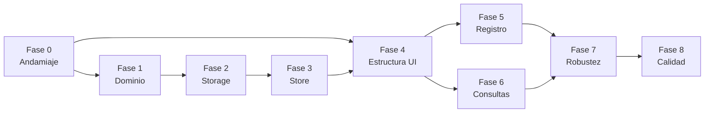

# Plan de implementación

## Aplicación web «Registro de inspección de vehículo y recepción de fruta» · Alimentos Bermúdez S.A.

| Elemento | Detalle |
| :---- | :---- |
| Documento | `tasks.md` |
| Versión | 1.0.0 |
| Fecha | 25 de octubre de 2026 |
| Entradas | `requirements.md` v1.1.0, `docs/design.md` v1.2.0 (DD-01 a DD-13), `data-contract.json` v1.0.0, `docs/wireframes/` 00 a 07, `CLAUDE.md` |
| Stack | D-01: HTML, CSS y JavaScript nativo con ES Modules, `// @ts-check` + JSDoc, `node --test`, `scripts/serve.js`. Sin dependencias. |

---

## Cómo leer este plan

- Las fases van **de adentro hacia afuera**, siguiendo las capas de REQ-TEC-09: primero reglas puras (`src/domain/`), luego persistencia (`src/state/storage.js`), luego estado (`src/state/store.js`) y al final la interfaz (`src/ui/`). Ninguna fase depende de una posterior.
- Cada tarea tiene un ID `T-<fase>.<n>`, los archivos que toca, los REQ / INV / DD que satisface y un **criterio de terminado** verificable.
- Cada fase termina con un **criterio de salida**. No se empieza la fase siguiente hasta cumplirlo.
- Los commits citan el ID de la tarea y los REQ / INV que cubren (por ejemplo, `T-1.6 valorarLote · REQ-LOT-11..15, INV-13`).
- Ya no quedan requerimientos [Propuesto] ni decisiones pendientes: P-01, P-04, P-06, P-07 y DD-12 fueron resueltas por el Head Chef el 25/10/2026 (ver requirements §13.2 y design §14), y Q-01 a Q-04 al final de este documento.

### Resumen de fases

| Fase | Nombre | Capa | Resultado verificable |
| :---- | :---- | :---- | :---- |
| 0 | Andamiaje | raíz, `scripts/`, `tests/helpers/` | `node scripts/serve.js` sirve un `index.html` vacío; `node --test` corre sin pruebas fallidas. |
| 1 | Dominio puro | `src/domain/` | Todas las reglas con pruebas de borde (sección 9 de requirements). |
| 2 | Persistencia | `src/state/storage.js` | Guardia de invariantes; INV-01 a INV-20 con prueba cada uno. |
| 3 | Estado global | `src/state/store.js` | Escenarios de los requerimientos probados con reloj y storage simulados. |
| 4 | Estructura de la interfaz | `index.html`, `styles/`, `src/ui/` (base) | Menú, encabezado, reloj, enrutador y pantalla «Criterios de aceptación». |
| 5 | Pantalla «Registro de recepción» | `src/ui/registro/` | Flujo completo: inspección → lotes → finalizar / cancelar. |
| 6 | Pantalla «Consultas» | `src/ui/consultas.js` | Búsqueda por placa y por número de lote, detalle en solo lectura. |
| 7 | Robustez | `storage`, `store`, `app.js` | Varias pestañas, datos dañados, sin espacio, almacenamiento no disponible, salida con cambios sin guardar. |
| 8 | Calidad y cierre | `tests/`, checklist | Rendimiento, accesibilidad, verificación manual por wireframe, trazabilidad. |

---

## Fase 0 · Andamiaje

**Objetivo:** dejar el esqueleto del proyecto, el servidor estático y el arnés de pruebas, sin lógica de negocio.

- [x] **T-0.1 · Estructura de carpetas.**
  Crear la estructura de `docs/design.md` §5: `assets/`, `styles/`, `scripts/`, `src/config/`, `src/domain/`, `src/state/`, `src/ui/registro/`, `tests/helpers/`, `tests/domain/`, `tests/state/`, `tests/invariantes/`.
  Copiar `docs/wireframes/00 - Logo Alimentos Bermúdez.png` a `assets/logo-alimentos-bermudez.png`.
  *REQ-TEC-01, REQ-TEC-09, REQ-UNC-18.*
  **Terminado:** la estructura existe y no hay `package.json` con dependencias ni `node_modules`.

- [x] **T-0.2 · Servidor estático `scripts/serve.js`.**
  `node:http` en `http://localhost:3000`; entrega solo archivos estáticos con tipo MIME por extensión (`.html`, `.js`, `.css`, `.png`, `.json`, `.svg`); responde 404 a lo demás; rechaza rutas con `..`; `/` sirve `index.html`. Sin API ni lógica de negocio.
  *REQ-TEC-03, RNF-01.*
  **Terminado:** `node scripts/serve.js` abre `index.html`; una petición a `/../CLAUDE.md` no sale de la raíz.

- [x] **T-0.3 · `index.html` mínimo.**
  Shell con `<aside>`, `<header>`, `<main>`, `<dialog>` y `<script type="module" src="src/ui/app.js">`. `lang="es"`, `<meta charset="utf-8">`, `<title>` con el nombre del formulario.
  *REQ-TEC-01, REQ-UNC-01.*
  **Terminado:** la página abre sin errores en consola.

- [x] **T-0.4 · Configuración de inspectores.**
  `src/config/inspectores.js`: `export const INSPECTORES = ['Melquisedec GP', 'Aurora V', 'Margarita C'];` con `// @ts-check`.
  *REQ-INS-06, REQ-TEC-06, RNF-02; contrato `x-configuracion.inspectores`.*
  **Terminado:** se importa estáticamente desde una prueba.

- [x] **T-0.5 · Tipos del dominio `src/domain/tipos.js`.**
  `@typedef` de `Producto`, `EstadoLote`, `InspeccionVehiculo`, `LoteMateriaPrima`, `Registro` (design §6.1) y de los tipos solo de memoria `Borrador`, `FormularioLote` (design §6.2).
  *REQ-TEC-02, INV-20.*
  **Terminado:** los campos coinciden uno a uno con `data-contract.json` (8 claves en la inspección, 12 en el lote).

- [x] **T-0.6 · `localStorage` simulado en memoria.**
  `tests/helpers/localStorageMemoria.js`: `getItem`, `setItem`, `removeItem`, `key`, `length`, `clear`, más un límite de bytes configurable que lanza un `DOMException` `QuotaExceededError`, y un modo «no disponible» que lanza en cualquier acceso.
  *REQ-TEC-10; base de REQ-PER-12, REQ-PER-14.*
  **Terminado:** prueba propia del helper pasa con `node --test`.

- [x] **T-0.7 · Prueba de reglas de arquitectura.**
  `tests/arquitectura.test.js` que recorre `src/` y falla si:
  1. la palabra `localStorage` aparece fuera de `src/state/storage.js` (REQ-TEC-05);
  2. aparece `fetch(` o `XMLHttpRequest` (REQ-TEC-04);
  3. aparece `toISOString` (REQ-TEC-07);
  4. un archivo `.js` no empieza con `// @ts-check` (REQ-TEC-02);
  5. un módulo de `src/domain/` importa algo fuera de `src/domain/` o usa `document` / `window` (REQ-TEC-09);
  6. un módulo de `src/ui/` importa `state/storage.js` (design §3.2).
  **Terminado:** la prueba pasa con el esqueleto vacío y falla si se introduce a propósito una violación.

**Criterio de salida de la fase 0:** `node --test` pasa; `node scripts/serve.js` sirve la página vacía en el puerto 3000.

---

## Fase 1 · Dominio puro (`src/domain/`)

**Objetivo:** todas las reglas de negocio como funciones puras, sin DOM ni `localStorage`, con pruebas de los valores de borde de la sección 9 de requirements. Orden sugerido según dependencias entre módulos.

- [x] **T-1.1 · `criterios.js`: única fuente de los números.**
  `PRODUCTOS`, `CRITERIOS_APROBACION`, `RANGOS_ENTRADA`, `PATRON_UN_DECIMAL`, `FORMULARIO` (copia de `x-formulario`), `MOTIVO_VEHICULO_NO_CUMPLE = 'No cumple: el vehículo no cumple con el chequeo'`. Todo con `Object.freeze`.
  *RNF-11, REQ-UNC-01, 02, 03; DD-03.*
  **Pruebas:** `tests/domain/criterios.test.js` lee `data-contract.json` con `node:fs` y compara `x-reglas.criteriosAprobacion`, `x-reglas.rangosEntrada`, `patronUnDecimal`, `$defs.Producto.enum` y `x-formulario` con las constantes. Cualquier desalineación falla.

- [x] **T-1.2 · `mensajes.js`: textos de error y aviso.**
  Objeto `MENSAJES` congelado con los textos de design §8.2 (DD-11) y funciones que los completan (`MENSAJES.loteRepetido('BN-0453')`, `MENSAJES.sinResultadosPlaca(texto)`, `MENSAJES.fueraRangoEntrada(min, max)`, `MENSAJES.loteGuardado(numeroLote, producto)` con las dos variantes de Q-01, etc.). También los textos de confirmación de RNF-05 (cambio a No cumple, Cancelar registro, Cerrar sin guardar, Quitar, Finalizar con cambios sin guardar).
  *RNF-06, REQ-CON-09, REQ-PER-12, REQ-LOT-24; DD-11; Q-01.*
  **Pruebas:** cada función produce el texto exacto aprobado; `loteGuardado(null, 'Malanga')` → «Lote de Malanga guardado. ¿Llegó otro lote en este vehículo?».

- [x] **T-1.3 · `normalizacion.js`.**
  `limpiarTexto(t)` → `trim`; vacío o solo espacios → `null`. `textoMayusculas(t)` → `limpiarTexto` + mayúsculas. `valorNormalizado(t)` → sin espacios ni guiones y en mayúsculas.
  *REQ-VAL-17, 18, 19; REQ-INS-04; REQ-LOT-35; REQ-CON-02; INV-17, INV-18.*
  **Pruebas:** `'  '` → `null`; `' cl 76543 '` → `'CL 76543'`; `ABC-123`, `abc123`, `ABC 123` dan el mismo valor normalizado; `undefined` nunca sale como resultado.

- [x] **T-1.4 · `tiempo.js`.**
  `ahoraCostaRica(instante)` con `Intl.DateTimeFormat('en-CA', { timeZone: 'America/Costa_Rica', hourCycle: 'h23', … }).formatToParts` → `{ fecha, fechaHora, segundos }`. `formatoFecha('2026-10-25')` → `25/10/2026`; `formatoHora('2026-10-25T16:47')` → `16:47`; `minutosTranscurridos(desde, hasta)`. Prohibido `toISOString()`.
  *REQ-TEC-07, REQ-INS-01, REQ-UI-02, REQ-UI-07, RNF-09; INV-02, INV-03.*
  **Pruebas:** instante UTC `2026-10-26T05:59Z` → `2026-10-25T23:59` en Costa Rica; medianoche; formato 24 h (`00:xx`, no `24:xx`); comparación de texto `horaFin < horaInicio`.

- [x] **T-1.5 · `inspectores.js`: `depurarInspectores(lista)`.**
  Omite vacíos y solo espacios, elimina repetidos comparando `trim` + minúsculas, conserva la primera aparición y el orden.
  *REQ-INS-06, REQ-VAL-30, REQ-VAL-31 (P-06 resuelta: bloquear si queda vacía; depurar sin avisar).*
  **Pruebas:** `['Aurora V', ' aurora v ', '', '  ', 'Margarita C']` → `['Aurora V', 'Margarita C']`; lista vacía → `[]`.

- [x] **T-1.6 · `validacion.js`: `validarParametro(texto, parametro)`.**
  Evalúa sobre el TEXTO, en el orden de design §8.2: vacío → coma → negativo → no numérico (`^\d+(\.\d+)?$`) → más de un decimal (`PATRON_UN_DECIMAL`) → fuera de `RANGOS_ENTRADA`. Devuelve `{ valor, error }`. Extremos incluidos.
  *REQ-VAL-01 a 07, 10, 11; REQ-TEC-08; INV-12.*
  **Pruebas de borde:** Brix `0.0` ✓, `30.0` ✓, `30.1` ✗, `-0.1` ✗; temperatura `50.0` ✓, `50.1` ✗; peso `1.0` ✓, `0.9` ✗, `5000.0` ✓, `5000.1` ✗; textos `4,5` (mensaje de punto decimal), `4.55` (un decimal), `abc`, `-3`, `  `, `4.` y `.5`.

- [x] **T-1.7 · `valoracion.js`.**
  `parametrosQueAplican(producto)` (claves con criterio no `null`), `valorarLote(entrada)` → `{ estado, motivoRechazo }` y `construirMotivoRechazo(fallos)`. Chequeo `false` → Rechazado con `MOTIVO_VEHICULO_NO_CUMPLE`. Algún parámetro aplicable `null` → `{ estado: null, motivoRechazo: null }`. Comparación `>= min && <= max` sin redondeo. Orden de fallos Brix, Temperatura, Calibre, Peso; calibre como «Fuera de calibre» sin valor ni rango (DD-04). `valorarLote` no recibe `observaciones`.
  *REQ-LOT-04, 11 a 16, 18; REQ-VAL-08, 09; REQ-UNC-03, 04, 05; INV-10, 11, 13, 14, 15, 16; DD-03, DD-04.*
  **Pruebas de borde:** temperatura `23.9` ✗ / `24.0` ✓ / `30.0` ✓ / `30.1` ✗; peso Malanga `399.9` ✗ / `400.0` ✓ / `2000.0` ✓ / `2000.1` ✗; Brix Banano `5.0` ✓ / `5.1` ✗; Brix Plátano `8.0` ✓ / `8.1` ✗; Brix Malanga `3.9` ✗ / `4.0` ✓ / `12.0` ✓ / `12.1` ✗; Banano «Fuera de calibre». Motivo exacto: `No cumple: Brix 6.2 (rango 2 a 5); Temperatura 31.0 °C (rango 24 a 30)` y `No cumple: Brix 6.2 (rango 2 a 5); Fuera de calibre`. Mismos datos → mismo resultado (INV-13).

- [x] **T-1.8 · `validacion.js`: `inspeccionCompleta` y `validarLoteParaGuardar`.**
  `inspeccionCompleta(inspeccion)` según `x-reglas.inspeccionCompleta`. `validarLoteParaGuardar(borrador, { registro, loteId })` devuelve errores por campo: inspección incompleta, producto sin elegir, número de lote repetido (normalizado, solo dentro de la misma inspección, excluyendo el propio lote y los `null`), parámetros aplicables inválidos cuando el chequeo es «Cumple», calibre sin elegir en Banano / Plátano. Con chequeo «No cumple» no exige parámetros.
  *REQ-INS-14; REQ-LOT-08, 22, 23, 29; REQ-VAL-12 a 16, 28, 29 (P-01 resuelta: se rechaza el guardado); REQ-UNC-13; INV-08, INV-09.*
  **Pruebas:** `BN-0453` vs `bn 0453` en la misma inspección ✗; el mismo número en otra inspección ✓; editar el propio lote sin cambiar el número ✓; dos lotes sin número ✓; Pendiente de valorar con parámetros vacíos ✗.

- [x] **T-1.9 · `borrador.js`.**
  `borradorVacio()`, `borradorDesdeLote(lote)` (números a texto), `cambiarProducto(b, p)` (vacía los que no aplican, conserva los que sí), `loteDesdeBorrador(b, { id, inspeccionId, chequeo })` (limpia textos, `numeroLote` en mayúsculas, parámetros que no aplican o con chequeo `false` en `null`, valora), `estadoVisible(b, chequeo, original)` (tabla de design §8.5), `tieneCambiosSinGuardar(b, original)` (design §8.6), `requiereAvisoObservaciones(estadoAnterior, estadoNuevo, observaciones)`.
  *REQ-LOT-02, 03, 06, 09, 10, 19, 21, 30, 31, 35; REQ-PER-07; INV-11, INV-17; DD-12 (confirmada).*
  **Pruebas:** cambiar Banano → Yuca conserva la temperatura y vacía Brix y calibre; los cinco textos de estado visible («Sin producto», «Faltan parámetros», «Pendiente de valorar», «Aprobado», «Rechazado»); un borrador nuevo sin tocar no tiene cambios sin guardar; espacios extra no cuentan como cambio; aviso de observaciones (DD-12) en los cinco escenarios confirmados: lote nuevo que pasa de Rechazado a Aprobado con observaciones → aviso; lote guardado Rechazado editado a Aprobado → aviso; lote Pendiente de valorar que queda Aprobado → sin aviso; sin observaciones → sin aviso; Rechazado → «Faltan parámetros» → Aprobado → aviso.

- [x] **T-1.10 · `registro.js`: transiciones puras.**
  `crearInspeccion(id, instante)` (todos los campos del inspector en `null`, `fecha` derivada de `horaInicio`), `actualizarCampo(insp, campo, valor)` (nunca toca `id`, `fecha`, `horaInicio`, `horaFin`), `aplicarChequeo(registro, valor)` (tabla de design §8.4), `agregarOReemplazarLote`, `quitarLote`, `contadores` (Aprobados / Rechazados / Pendientes), `condicionesFinalizacion` (lista de las que faltan), `finalizar(registro, instante)`. Ninguna función muta su entrada ni escribe `observaciones`.
  *REQ-INS-01, 03, 08, 09, 11, 13; REQ-REG-01, 02, 03; REQ-VAL-21, 22; INV-02, 03, 04, 10, 14, 16.*
  **Pruebas:** `true → false` con 3 lotes deja 3 Rechazados con parámetros `null` y motivo del vehículo; `false → true` deja `estado = null` y `motivoRechazo = null`; `false → true → false` vuelve a Rechazado; observaciones idénticas tras cada transición; finalizar cruzando la medianoche conserva `fecha`; condiciones de finalización con 0 lotes, inspección incompleta y lote pendiente.

- [x] **T-1.11 · `consultas.js`.**
  `buscarPorPlaca(registros, texto)` (solo finalizados, placa normalizada, `horaInicio` descendente), `buscarPorNumeroLote(registros, texto)` (solo finalizados, omite `numeroLote = null`, `horaInicio` descendente, DD-06), `resumenLotes(lotes)`.
  *REQ-CON-03, 05, 07, 08; REQ-VAL-19; DD-06.*
  **Pruebas:** `cl-0672` encuentra `CL-0672`; un registro en curso con la misma placa no aparece; orden del más reciente al más antiguo.

- [x] **T-1.12 · `validacionRegistro.js`: guardia de contrato e invariantes.**
  `inspeccionCumpleContrato(o)`, `loteCumpleContrato(o)` (claves exactas, tipos, enums, patrones de `$defs`, `allOf` condicionales, sin `""`, sin `undefined`) y `validarRegistro(nuevo, anterior, { loteEditadoId })` → `string[]` con los IDs de invariantes violados. Compara con la versión anterior: `id`, `fecha`, `horaInicio` no cambian; observaciones solo cambian en `loteEditadoId`; `estado` = `valorarLote(...)`; pertenencia de lotes; unicidad de `numeroLote`; UUID v4.
  *REQ-PER-05, 13; REQ-UNC-17; INV-01 a INV-20; DD-13.*
  **Pruebas:** un caso válido y al menos un caso inválido por invariante (se reutilizan en la fase 2).

**Criterio de salida de la fase 1:** `node --test tests/domain` pasa con todos los valores de borde de requirements §9; `tests/arquitectura.test.js` sigue en verde.

---

## Fase 2 · Persistencia (`src/state/storage.js`)

**Objetivo:** el único módulo que toca `localStorage`, con esquema de claves DD-01 y guardia de invariantes antes de cada escritura.

- [x] **T-2.1 · `crearStorage(almacen)` y `disponible()`.**
  Inyección del almacén (por defecto `globalThis.localStorage`, dentro de `try/catch`). `disponible()` prueba `setItem` / `removeItem`.
  *REQ-PER-01, REQ-PER-14 (P-04 resuelta), REQ-TEC-05.*

- [x] **T-2.2 · `leerRegistros()`.**
  Recorre solo claves `foas07.v1.*`; `JSON.parse` en `try/catch`; valida con `inspeccionCumpleContrato` / `loteCumpleContrato`; omite lotes con `inspeccionId` distinto; informa `enCursoConLotesOmitidos`; resuelve la finalización interrumpida (si `enCurso.id` existe como `finalizado.<id>`, prevalece el finalizado y se elimina `enCurso`). Devuelve `{ enCurso, finalizados, avisos, enCursoConLotesOmitidos }`.
  *REQ-REG-09, REQ-PER-11, 13, 16; DD-05; design §7.4.3.*
  **Pruebas:** JSON roto, registro fuera de contrato, lote huérfano, finalización interrumpida, claves de otra app ignoradas.

- [x] **T-2.3 · Escrituras con guardia.**
  `guardarRegistroEnCurso(registro, { loteEditadoId })`, `guardarRegistroFinalizado(registro)` (escribe `finalizado.<id>` y después elimina `enCurso`), `eliminarRegistroEnCurso(id)`. Cada una: bloqueo por pestaña → leer anterior → `validarRegistro` → reglas propias (design §7.4.4) → `setItem` en `try/catch` con detección de cuota (`QuotaExceededError`, códigos 22 y 1014). Devuelven `ResultadoEscritura`.
  *REQ-PER-02, 03, 04, 05, 09, 10, 12; REQ-REG-07; REQ-VAL-27; INV-01, 04, 05, 06.*
  **Pruebas:** escritura correcta; cuota excedida → `{ ok: false, motivo: 'espacio' }` y `localStorage` sin cambios.

- [x] **T-2.4 · Señal entre pestañas.**
  `reclamarPestanaActiva()`, `bloquearEscrituras()`, `desbloquearEscrituras()`, `alCambiarEnOtraPestana(fn)` (escucha `storage` solo de claves `foas07.v1.*`). Con bloqueo activo, toda escritura devuelve `motivo: 'soloLectura'`.
  *REQ-VAL-26, 32 (P-07 resuelta); REQ-PER-15; DD-02.*

- [x] **T-2.5 · Pruebas de invariantes `tests/invariantes/inv-01.test.js` … `inv-20.test.js`.**
  Un archivo por invariante que **intenta violarlo** escribiendo con `storage` y verifica que la escritura se rechaza y `localStorage` queda idéntico. Casos de design §10 (por ejemplo: segundo registro en curso con otro `id`; reescribir `horaInicio`; finalizar sin lotes; reescribir un finalizado; cancelar y buscar rastro del `id`; `'Platano'` sin tilde; `BN-0453` y `bn 0453`; chequeo `false` con lote Aprobado; Yuca con `brix`; `brix = 30.1`; Aprobado con Brix 6.2 en Banano; `estado = 'Pendiente'`; Rechazado sin motivo; observaciones alteradas en un lote no editado; `productor = '  '`; `placa = 'cl76543 '`; `id` no v4; campo extra).
  *INV-01 a INV-20; CLAUDE.md «Calidad».*

**Criterio de salida de la fase 2:** los 20 archivos de invariantes y `tests/state/storage.test.js` pasan; `localStorage` solo aparece en `storage.js`.

---

## Fase 3 · Estado global (`src/state/store.js`)

**Objetivo:** estado en memoria, acciones y suscripción, con escritura pesimista. Sin DOM.

- [x] **T-3.1 · `crearStore({ storage, reloj, generarId })`.**
  `obtenerEstado()`, `suscribir(fn)` → función para cancelar, `notificar()`. Forma de `EstadoApp` de design §7.2. Selectores derivados (`inspeccionCompleta`, `contadores`, `condicionesFinalizacion`, `productoresSugeridos`, `estadoVisible`) calculados desde `src/domain/`, nunca guardados.
  *REQ-TEC-09; INV-13.*

- [x] **T-3.2 · `iniciar()`.**
  Verifica disponibilidad, reclama la pestaña activa, lee registros, retoma el registro en curso, publica avisos de datos omitidos; si `enCursoConLotesOmitidos`, entra en solo lectura con «Cancelar registro» como única acción.
  *REQ-REG-09, REQ-PER-13, 14; DD-02, DD-05.*

- [x] **T-3.3 · Acciones de la inspección.**
  `actualizarCampoInspeccion(campo, valor)` (relee antes de crear; crea en el primer dato; normaliza; persiste) y `cambiarChequeo(valor)` (aplica `aplicarChequeo`, persiste todos los lotes en una escritura, actualiza `original` del formulario abierto y revalora o vacía el borrador según DD-08). Ambas actualizan `ultimoGuardado` tras `{ ok: true }`.
  *REQ-INS-01, 03, 04, 09, 11, 13, 15, 16; REQ-PER-02, 04; REQ-VAL-27; DD-08; Q-02.*

- [x] **T-3.4 · Acciones del lote.**
  `abrirLoteNuevo()`, `editarLote(id)`, `actualizarBorrador(campo, valor)` (errores al vuelo, `cambiarProducto`, `ultimoEstadoCalculado`, aviso de observaciones), `guardarLote()` (valida → construye → persiste con `loteEditadoId` → cierra y publica `ultimoLoteGuardado`), `cerrarLote()`, `quitarLote(id)` (cierra el formulario si es el mismo lote, DD-07). `guardarLote` y `quitarLote` también actualizan `ultimoGuardado` tras `{ ok: true }` (Q-02).
  *REQ-LOT-02 a 35; REQ-PER-03; REQ-VAL-29; DD-07, DD-12; Q-02.*

- [x] **T-3.5 · Acciones del registro.**
  `finalizarRegistro()` (verifica condiciones, asigna `horaFin`, persiste, limpia, aviso si `horaFin < horaInicio`) y `cancelarRegistro()` (elimina y limpia). Tras ambas: `registroEnCurso = null`, `formularioLote = null`.
  *REQ-REG-02, 03, 07, 10; REQ-PER-09, 10; REQ-VAL-21, 22.*

- [x] **T-3.6 · Navegación, consultas y pestañas.**
  `navegar(pantalla)` (no toca registro ni borrador), `cambiarModoConsulta`, `buscar()`, `verRegistro(id)`, `verLote(id)`, `recargarDesdeOtraPestana()`, `continuarEnEstaPestana()`. `verRegistro` y `verLote` buscan solo entre los registros finalizados, así que también funcionan al recargar sobre una ruta de detalle (Q-03).
  *REQ-UI-03, 08; REQ-CON-01 a 10; REQ-VAL-26, 32; Q-03.*

- [x] **T-3.7 · Escritura pesimista.**
  Toda acción que persiste confirma en memoria solo tras `{ ok: true }`; si falla, publica el error y conserva memoria y formulario sin cambios.
  *REQ-PER-12; design §7.3.*

- [x] **T-3.8 · Pruebas de escenarios `tests/state/store.test.js`.**
  Con reloj fijo, `generarId` determinista y storage en memoria: primer dato crea la inspección; borrar la placa conserva `horaInicio`; recarga retoma el registro; cambio de chequeo con lotes; lote Pendiente de valorar completado; «Cerrar sin guardar» de un lote nuevo con vehículo que no cumple no deja nada en `localStorage`; «Cerrar sin guardar» de un lote editado conserva los cambios del sistema; quitar el lote abierto; finalizar bloqueado; finalizar cruzando la medianoche; cancelar con rechazados; cuota excedida al guardar lote conserva el borrador.
  *REQ-LOT-32, 33; REQ-REG-09; REQ-INS-03; REQ-PER-12.*

**Criterio de salida de la fase 3:** todos los escenarios pasan sin DOM; ningún módulo de `src/state/` importa `src/ui/`.

---

## Fase 4 · Estructura de la interfaz

**Objetivo:** el marco visual común a las tres pantallas y la pantalla más simple («Criterios de aceptación»).

- [x] **T-4.1 · Estilos `styles/tokens.css`, `base.css`, `componentes.css`.**
  Variables CSS: mostaza del menú, fondo crema, verde Aprobado, rojo Rechazado / Cancelar, ámbar Pendientes, `--color-banano` (amarillo), `--color-platano` (verde), `--color-yuca` (café claro), `--color-malanga` (morado). Foco visible `:focus-visible` de 3 px; rejilla de dos columnas desde 1024 px; segmentados con radios; insignias; tarjetas; tablas; campos «Sistema» con borde punteado (WF-01, WF-02).
  *REQ-UNC-18, RNF-07, RNF-08; WF-00 a WF-07.*
  **Terminado:** contraste de texto ≥ 4.5:1 verificado para cada par de colores usado.

- [x] **T-4.2 · `comunes.js`.**
  `confirmar(mensaje, { aceptar, cancelar })` con `<dialog>.showModal()`, foco inicial en el botón seguro, `Esc` = «No», devuelve `Promise<boolean>`. `accionProtegida(boton, fn)` deshabilita mientras procesa e ignora clics repetidos. Ayudas de DOM (`crear`, `textoSeguro` con `textContent`) y de error junto al campo (`aria-invalid`, `aria-describedby`).
  *RNF-05, RNF-06, RNF-08; REQ-VAL-23; REQ-INS-12, REQ-REG-08.*

- [x] **T-4.3 · `layout.js`.**
  `MenuLateral` (logo, «Calidad · Recepción de materia prima», secciones Operación / Referencia, insignia «En curso», `aria-current="page"`, pie «Formulario FO-AS-07 · v13» y leyenda de almacenamiento local si está disponible); `EncabezadoFormulario` desde `FORMULARIO` con fechas DD/MM/YYYY; `Reloj` HH:mm:ss + DD/MM/YYYY · Costa Rica, tic de 1 s solo con `visibilityState = 'visible'`; `ZonaAvisos` con `aria-live="polite"`.
  *REQ-UI-01, 02, 03, 04, 06; REQ-UNC-01, 18.*

- [x] **T-4.4 · `app.js`: arranque y enrutador por hash.**
  Crea el store, llama `iniciar()`, monta el layout y la pantalla según `#/registro` (por defecto), `#/consultas`, `#/criterios`; escucha `hashchange`. Rutas de detalle de Consultas (Q-03): `#/consultas/<inspeccionId>` (registro) y `#/consultas/<inspeccionId>/lote/<loteId>` (lote con su inspección). Ambas resaltan «Consultas» en el menú.
  *REQ-UI-03, 08; DD-09; Q-03.*

- [x] **T-4.5 · `criterios.js` (UI): pantalla «Criterios de aceptación».**
  Rótulo «RN-06 · RN-15», texto de extremos incluidos sin redondeo y tabla generada desde `CRITERIOS_APROBACION` («No aplica» cuando el criterio es `null`), con punto de color por producto.
  *REQ-UI-05, RNF-11; WF-07.*
  **Terminado:** la tabla coincide con WF-07 y no hay ningún número escrito en el HTML.

**Criterio de salida de la fase 4:** las tres rutas abren; el reloj avanza; «Criterios de aceptación» coincide con WF-07; navegación completa con teclado.

---

## Fase 5 · Pantalla «Registro de recepción» (`src/ui/registro/`)

**Objetivo:** el flujo principal de WF-01 a WF-05.

- [x] **T-5.1 · `pantalla.js`.**
  Rótulo «FO-AS-07», título «Registro de inspección de vehículo y recepción de fruta», subtítulo de WF-01 (solo en esta pantalla, Q-04) y montaje de las tres zonas: `TarjetaInspeccion`, `SeccionLotes`, `PanelEstado`.
  *WF-01; Q-04.*

- [x] **T-5.2 · `inspeccion.js`: `TarjetaInspeccion`.**
  Fecha, hora de inicio y hora de fin como `<output>` con etiqueta «Sistema» («Al finalizar» mientras no hay `horaFin`); placa (mayúsculas al `blur`); productor con `<input list>` + `<datalist>`; `<select>` de inspectores depurados sin opción inicial (agrega el nombre guardado si ya no está en la configuración; deshabilitado con aviso si la lista queda vacía); chequeo como `fieldset` de dos radios sin valor por defecto; confirmación al pasar de «Cumple» a «No cumple» con lotes (cuántos lotes y, si aplica, el formulario abierto), y vuelta a «Cumple» si se rechaza; check de inspección completa; indicador «Guardado en este equipo · HH:mm».
  *REQ-INS-01 a 16; REQ-VAL-30 (P-06 resuelta); DD-08; WF-01, WF-02.*

- [x] **T-5.3 · `lotes.js`: `SeccionLotes` y `TablaLotes`.**
  Sección con `inert` + `aria-disabled` y botones `disabled` mientras la inspección no esté completa (el formulario abierto se conserva visible y deshabilitado, DD-10). Contador «N lote(s) registrados». Tabla Lote / OC, Producto (punto de color + nombre), Parámetros con unidades y un decimal (`Brix 8.0`, `26.0 °C`, `1235.0 g/pieza`), Estado («Aprobado», «Rechazado · No se recibe», «Pendiente de valorar»), «Editar» y «Quitar» con confirmación que nombra producto y número de lote.
  *REQ-LOT-01, 20, 25, 26, 27, 28; REQ-VAL-20; DD-07, DD-10; WF-03, WF-04.*

- [x] **T-5.4 · `lotes.js`: `FormularioLote`.**
  Encabezado «Lote nuevo» / edición con el estado visible; producto como radios con color generados desde `PRODUCTOS`; número de lote y orden de compra (opcionales); parámetros según producto con leyenda de rangos (solo con «Cumple»), deshabilitados con «No cumple»; calibre como dos radios sin valor por defecto; motivo del rechazo como `<output>` con «lo escribe el sistema» y «—» si está vacío; observaciones; aviso no bloqueante de REQ-LOT-19 junto a Observaciones; errores junto a cada campo; «Guardar lote» y «Cerrar sin guardar» (confirmación solo con cambios sin guardar). «+ Lote» confirma si hay cambios sin guardar.
  *REQ-LOT-02 a 19, 21, 22, 23, 24, 29 a 34; REQ-VAL-01 a 16, 23, 24, 28, 29; REQ-UNC-04, 06, 10, 11; DD-12; WF-03.*

- [x] **T-5.5 · `lotes.js`: `AvisoLoteGuardado`.**
  Tras guardar: «Lote guardado como {numeroLote}. ¿Llegó otro lote en este vehículo?» con «+ Lote». Si el lote no tiene número: «Lote de {producto} guardado. ¿Llegó otro lote en este vehículo?» (Q-01). Ambos textos salen de `MENSAJES`.
  *REQ-LOT-24; WF-04; Q-01.*

- [x] **T-5.6 · `panelEstado.js`: `PanelEstado`.**
  Insignia «En curso», placa, inicio DD/MM/YYYY HH:mm, transcurrido en minutos (tic del reloj), contadores Aprobados / Rechazados / Pendientes, tres condiciones con check, «Finalizar registro» (mensaje con cada condición que falta; confirmación si hay cambios sin guardar), «Cancelar registro» (confirmación con cuántos rechazados se perderán) y la nota «Al finalizar se asigna la hora de fin y el registro pasa a consultas en solo lectura». Ambos botones con `accionProtegida`.
  *REQ-REG-01 a 08, 10; REQ-VAL-21, 23; WF-05.*

**Criterio de salida de la fase 5:** recorrido manual completo en el navegador: crear inspección, guardar lotes de los cuatro productos (aprobados y rechazados), cambiar el chequeo en ambos sentidos, editar, quitar, recargar a mitad (se retoma), finalizar y cancelar. La pantalla coincide con WF-01 a WF-05.

---

## Fase 6 · Pantalla «Consultas» (`src/ui/consultas.js`)

- [x] **T-6.1 · `PantallaConsultas`.**
  Rótulo «Registros finalizados · Solo lectura», título «Consultas», texto de ayuda, selector «Por placa / Por número de lote» (radios segmentados), campo de búsqueda con ejemplo y «Buscar» deshabilitado con texto vacío o solo espacios. `Enter` en el campo ejecuta la búsqueda.
  *REQ-CON-01, 02; WF-06.*

- [x] **T-6.2 · `ResultadosPorPlaca`.**
  Tarjeta «Inspecciones registradas» con «N finalizada(s) · de la más reciente a la más antigua»; columnas Fecha y hora (`DD/MM/YYYY HH:mm–HH:mm`), Placa, Productor / Inspector, Chequeo (insignia), Lotes (total + aprob. + rech.) y «Ver».
  *REQ-CON-03, 07, 09; WF-06.*

- [x] **T-6.3 · `ResultadosPorLote`.**
  Una fila por lote coincidente con fecha, placa y productor de su inspección, del más reciente al más antiguo; sin lotes con `numeroLote = null`.
  *REQ-CON-05, 07, 08, 09; DD-06.*

- [x] **T-6.4 · `DetalleRegistro`.**
  Vista aparte en su propia ruta (Q-03), que reemplaza los resultados. Muestra todos los datos de la inspección (incluido el inspector tal como se guardó) y de todos sus lotes, incluidos los sin número, o el lote elegido con su inspección obtenida por `inspeccionId`. Sin ningún control de edición, eliminación ni cancelación. Botón «Volver a los resultados» equivalente a «Atrás» del navegador. Si el `id` de la ruta no corresponde a un registro finalizado (por ejemplo, el registro en curso), no se muestra ningún dato y se indica que no hay un registro finalizado con ese identificador (REQ-CON-07).
  *REQ-CON-04, 06, 07, 10; REQ-INS-07; REQ-REG-05; REQ-UNC-12; Q-03.*

**Criterio de salida de la fase 6:** con registros finalizados de prueba, las búsquedas `cl-0672`, `CL 0672` y `cl0672` devuelven lo mismo; un registro en curso nunca aparece; la pantalla coincide con WF-06.

---

## Fase 7 · Robustez

- [x] **T-7.1 · Cambios sin guardar al salir.**
  `beforeunload` con `preventDefault()` solo si `tieneCambiosSinGuardar`.
  *REQ-VAL-25.*

- [x] **T-7.2 · Varias pestañas.**
  Conectar `alCambiarEnOtraPestana` con `recargarDesdeOtraPestana`; toda la UI de edición deshabilitada en solo lectura; aviso «El registro se está editando en otra pestaña» con el botón «Continuar en esta pestaña».
  *REQ-VAL-26, 32 (P-07 resuelta); REQ-PER-15; DD-02.*
  **Verificación manual:** dos pestañas; editar en B deja A en solo lectura; «Continuar en esta pestaña» en A invierte los papeles.

- [x] **T-7.3 · Datos dañados.**
  Avisos de registros omitidos en `ZonaAvisos`; registro en curso con un lote dañado en solo lectura con «Cancelar registro» como única acción y el mensaje de DD-05.
  *REQ-PER-11, 13; DD-05.*

- [x] **T-7.4 · Almacenamiento no disponible y sin espacio.**
  Sin `localStorage`: aviso «Los registros no se podrán guardar en este equipo», tarjeta de inspección y sección de lotes deshabilitadas, leyenda del menú oculta; Consultas y Criterios siguen abriendo, y Consultas muestra el mismo aviso en lugar de resultados. Cuota excedida: mensaje `role="alert"` y datos conservados en el formulario.
  *REQ-PER-14 (P-04 resuelta), REQ-PER-12, REQ-UI-06.*

- [x] **T-7.5 · Aviso de reloj del equipo.**
  Al finalizar con `horaFin < horaInicio`, aviso para revisar la fecha y hora del equipo; el registro se finaliza igual.
  *REQ-VAL-21.*

**Criterio de salida de la fase 7:** cada escenario se reproduce a mano en el navegador (manipulando `localStorage` desde la consola para los datos dañados) y tiene su prueba en `tests/state/`.

---

## Fase 8 · Calidad y cierre

- [x] **T-8.1 · Prueba de rendimiento `tests/rendimiento.test.js`.**
  5 000 lotes repartidos en registros finalizados; `guardarLote` + recálculo < 200 ms; `leerRegistros` + `buscarPorPlaca` / `buscarPorNumeroLote` < 1 s, medido con `performance.now()`.
  *RNF-03.*

- [x] **T-8.2 · Revisión de accesibilidad (WCAG 2.1 AA).**
  Cada control con `<label for>`; grupos con `fieldset` + `legend`; recorrido completo solo con teclado (incluidos los diálogos); foco visible; contraste; estados no comunicados solo por color.
  *RNF-08.*

- [ ] **T-8.3 · Checklist de verificación manual por wireframe.**
  `docs/checklist-ui.md` con un apartado por WF-01 a WF-07 y los REQ que cada pantalla demuestra; se completa en Chrome, Edge y Firefox (dos últimas versiones) a 1024 px y en escritorio, y sin conexión tras abrir la página.
  *REQ-UNC-18, RNF-01, RNF-04, RNF-07; design §11 «UI».*

- [x] **T-8.4 · Matriz de cobertura.**
  Agregar a este documento (o a `docs/design.md` §13) la columna «Prueba» con el archivo que verifica cada REQ de dominio, storage y store; confirmar que INV-01 a INV-20 tienen prueba y que todos los valores de borde de requirements §9 están cubiertos.
  *RNF-12; CLAUDE.md «Calidad».*

- [x] **T-8.5 · Registro de decisiones en el PR final.**
  Listar las decisiones del Head Chef del 25/10/2026 que interpretan o amplían los requerimientos, con la tarea y la prueba que las cubren: P-01 (REQ-VAL-29), P-04 (REQ-PER-14), P-06 (REQ-VAL-30, 31), P-07 (REQ-VAL-32), DD-12 (REQ-LOT-19) y Q-01 a Q-04.

**Criterio de salida de la fase 8:** `node --test` en verde, checklist manual completado en los tres navegadores, cero violaciones en `tests/arquitectura.test.js`.

---

## Dependencias entre fases

Dentro de la fase 1, el orden respeta las importaciones: `criterios` y `mensajes` → `normalizacion` y `tiempo` → `inspectores` → `validacion` (parámetro) → `valoracion` → `validacion` (lote) → `borrador` → `registro` → `consultas` → `validacionRegistro`. Las fases 5 y 6 pueden avanzar en paralelo una vez cerrada la fase 4.

---

## Decisiones del Head Chef sobre el plan

Puntos que el análisis detectó y que las fuentes no resolvían del todo. El Head Chef los resolvió el 25/10/2026 eligiendo la opción A en los cuatro casos.

| ID | Pregunta | Decisión | Tarea afectada |
| :---- | :---- | :---- | :---- |
| Q-01 | WF-04 muestra «Lote guardado como **LT105490**…». ¿Qué texto se muestra si el lote se guarda **sin** número de lote (opcional por REQ-LOT-08)? | Se nombra el producto: «Lote de {producto} guardado. ¿Llegó otro lote en este vehículo?». Con número de lote se mantiene el texto de WF-04. | T-1.2, T-5.5 |
| Q-02 | ¿El indicador «Guardado en este equipo · HH:mm» (REQ-INS-16) se actualiza solo con cambios de la inspección? | Se actualiza con **cualquier** escritura exitosa del registro en curso: cambios de la inspección, cambio de chequeo, «Guardar lote» y «Quitar». Amplía la lectura literal de REQ-INS-16. | T-3.3, T-3.4, T-5.2 |
| Q-03 | ¿Dónde se muestra el detalle de «Ver», que ningún wireframe dibuja? | En una vista aparte con ruta propia. «Atrás» vuelve a los resultados y recargar conserva el detalle (en línea con DD-09). | T-4.4, T-3.6, T-6.4 |
| Q-04 | ¿«Consultas» y «Criterios de aceptación» usan sus propios títulos, como en WF-06 y WF-07? | Sí. Cada pantalla tiene su rótulo, título y texto; el encabezado FO-AS-07 y el reloj son comunes a las tres. | T-4.5, T-5.1, T-6.1 |

---

## Estado de ejecución (26/10/2026)

Las fases 0 a 8 están implementadas. `node --test` pasa con 215 pruebas, sin dependencias. Queda abierta **T-8.3**: el checklist `docs/checklist-ui.md` se recorrió en el navegador integrado (Chromium) a 1280 px y 1024 px; faltan Chrome estable, Edge, Firefox y la prueba sin conexión, marcados con ⬜.

El proyecto no es un repositorio git, así que no hay commits ni PR. Cuando se cree el repositorio, los commits deben citar la tarea y los REQ / INV (por ejemplo, `T-1.7 valorarLote · REQ-LOT-11..15, INV-13`).

### Matriz de cobertura (T-8.4)

| Área | REQ / INV | Prueba |
| :---- | :---- | :---- |
| Criterios y formulario | RNF-11; REQ-UNC-01, 02, 03; REQ-TEC-02 (8 y 12 claves) | `tests/domain/criterios.test.js` |
| Mensajes | RNF-05, RNF-06; REQ-CON-09; REQ-PER-12; REQ-LOT-24 (Q-01) | `tests/domain/mensajes.test.js` |
| Normalización | REQ-VAL-17, 18, 19; REQ-INS-04; REQ-LOT-35 | `tests/domain/normalizacion.test.js` |
| Tiempo | REQ-TEC-07; REQ-UI-02, 07; REQ-VAL-21, 22; REQ-REG-01 (transcurrido) | `tests/domain/tiempo.test.js` |
| Inspectores | REQ-INS-06; REQ-VAL-30, 31; REQ-TEC-06 | `tests/domain/inspectores.test.js`, `tests/state/store.test.js` |
| Validación | REQ-VAL-01 a 07, 10 a 16, 28, 29; REQ-LOT-08, 22, 23; REQ-INS-14; REQ-UNC-13; REQ-PER-05 (una línea) | `tests/domain/validacion.test.js` |
| Valoración | REQ-LOT-04, 11 a 15; REQ-VAL-08, 09; DD-03, DD-04 | `tests/domain/valoracion.test.js` |
| Borrador | REQ-LOT-09, 10, 19, 21, 30, 31, 35; REQ-PER-07; DD-12 | `tests/domain/borrador.test.js` |
| Transiciones del registro | REQ-INS-01, 03, 11, 13; REQ-REG-01, 02, 03; REQ-LOT-27; REQ-VAL-22 | `tests/domain/registro.test.js` |
| Consultas (dominio) | REQ-CON-03, 05, 07, 08; DD-06 | `tests/domain/consultas.test.js` |
| Guardia de contrato | REQ-PER-05, 13; INV-02 a INV-20 | `tests/domain/validacionRegistro.test.js` |
| Persistencia | REQ-PER-01, 09, 11, 12, 13, 14, 15; REQ-VAL-26, 32; DD-01, DD-02, DD-05 | `tests/state/storage.test.js` |
| Store (escenarios) | REQ-INS-01, 03, 16 (Q-02); REQ-LOT-22 a 24, 29, 32, 33; REQ-REG-02, 03, 07, 09; REQ-VAL-14, 21, 22, 27, 29; REQ-PER-12, 14; REQ-UI-08; REQ-CON-01 a 10 (Q-03); DD-05, DD-07, DD-08, DD-12 | `tests/state/store.test.js` |
| Robustez | REQ-VAL-25, 26, 32; REQ-PER-12 a 15 | `tests/state/robustez.test.js` |
| Invariantes | INV-01 a INV-20, un archivo cada uno | `tests/invariantes/inv-01.test.js` … `inv-20.test.js` |
| Rendimiento | RNF-03 (5 000 lotes) | `tests/rendimiento.test.js` |
| Arquitectura | REQ-TEC-01, 02, 04, 05, 07, 09 | `tests/arquitectura.test.js` |
| Servidor | REQ-TEC-03 | `tests/servidor.test.js` |
| Contraste | RNF-08 (≥ 4.5:1) | `tests/contraste.test.js` |
| Interfaz | REQ-UI, REQ-UNC-18, RNF-04, RNF-07, RNF-08 | `docs/checklist-ui.md` (manual) |

**Valores de borde de requirements §9:** temperatura 23.9 / 24.0 / 30.0 / 30.1; peso 399.9 / 400.0 / 2000.0 / 2000.1; Brix 5.0 / 5.1 (Banano), 8.0 / 8.1 (Plátano), 3.9 / 4.0 / 12.0 / 12.1 (Malanga) en `valoracion.test.js`. Rango de entrada 0.0 / 30.0 / 30.1 / -0.1 / 50.0 / 50.1 / 1.0 / 0.9 / 5000.0 / 5000.1 y textos `4,5`, `4.55`, `abc`, `-3`, `  `, `4.`, `.5` en `validacion.test.js`. Normalización `ABC-123` = `abc123` = `ABC 123` en `normalizacion.test.js`.

### Registro de decisiones (T-8.5)

| Decisión (25/10/2026) | Requerimiento | Tarea | Prueba |
| :---- | :---- | :---- | :---- |
| P-01: un lote Pendiente de valorar con parámetros incompletos no se guarda | REQ-VAL-29 | T-1.8, T-3.4 | `validacion.test.js`, `store.test.js` («completar un lote Pendiente de valorar») |
| P-04: sin almacenamiento se avisa y se deshabilita el registro; Consultas y Criterios abren | REQ-PER-14 | T-3.2, T-7.4 | `store.test.js`, `robustez.test.js` |
| P-06: lista de inspectores depurada sin aviso; vacía bloquea el registro | REQ-VAL-30, 31 | T-1.5, T-5.2 | `inspectores.test.js`, `store.test.js` |
| P-07: botón «Continuar en esta pestaña» | REQ-VAL-32 | T-2.4, T-3.6, T-7.2 | `storage.test.js`, `robustez.test.js` |
| DD-12: el aviso de observaciones compara con el último estado calculado, también en lotes nuevos | REQ-LOT-19 | T-1.9, T-3.4 | `borrador.test.js`, `store.test.js` |
| Q-01: lote sin número → «Lote de {producto} guardado…» | REQ-LOT-24 | T-1.2, T-5.5 | `mensajes.test.js`, `store.test.js` |
| Q-02: «Guardado en este equipo · HH:mm» se actualiza con cualquier escritura del registro en curso | REQ-INS-16 | T-3.3, T-3.4 | `store.test.js` |
| Q-03: detalle de «Ver» en ruta propia (`#/consultas/<id>` y `…/lote/<loteId>`) | REQ-CON-04, 06 | T-3.6, T-4.4, T-6.4 | `store.test.js` + checklist WF-06 |
| Q-04: cada pantalla con su rótulo y título; encabezado y reloj comunes | REQ-UI-01 | T-4.5, T-5.1, T-6.1 | checklist WF-01, WF-06, WF-07 |

### Puntos para revisión del Head Chef

1. **Observaciones en varias líneas.** El patrón `TextoNoVacio` del contrato (`^\S(?:.*\S)?$`) no admite saltos de línea, pero WF-03 dibuja Observaciones como un área de texto. Se respetó el contrato: si el texto tiene un salto de línea, se muestra «Escriba este texto en una sola línea.» junto al campo y el lote no se guarda. Si se prefiere admitir varias líneas, hay que cambiar el contrato (versión nueva) y `validacionRegistro.js`.
2. **Colores con contraste AA.** El mostaza de WF-01 (`#c68e0e`) con texto blanco da 2.9:1. El menú usa texto café oscuro sobre mostaza y los botones principales usan un mostaza más oscuro (`#8c6100`, 5.5:1). Todos los pares están en `tests/contraste.test.js`.
3. **«Última revisión» en el encabezado.** WF-01 no la dibuja, pero REQ-UI-01 la exige; se muestra.
